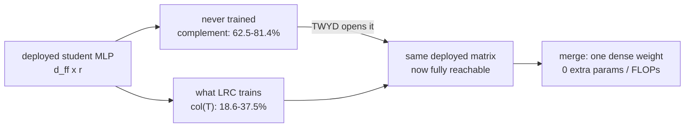
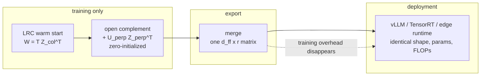
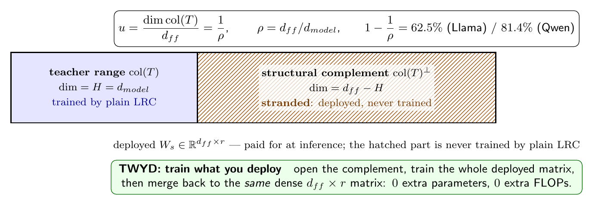
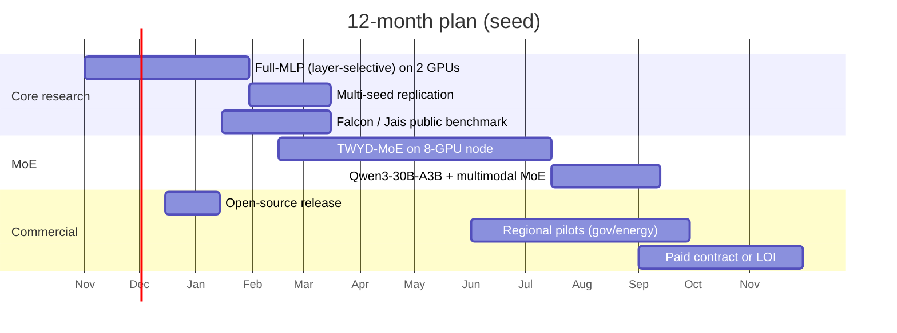
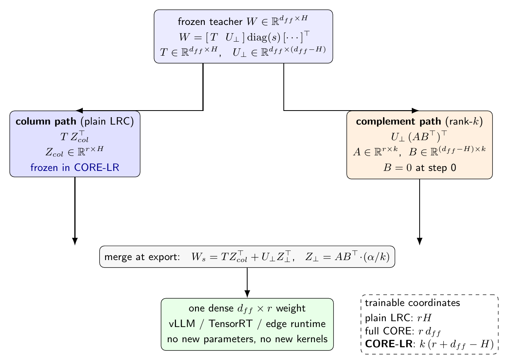

# OmniReach AI

**Half the size. Near-teacher accuracy. Zero inference overhead.**

Model compression for sovereign and edge AI.

[The problem](#the-problem) · [The insight](#the-insight) · [Evidence](#evidence) · [Product](#product) · [Roadmap](#roadmap) · [Team](#team) · [The ask](#the-ask)

---

<table>
<tr>
<td align="center" width="33%"><h2>~10B</h2>compression-stage tokens vs 50–94B for prune-and-retrain, ~9T for the official model</td>
<td align="center" width="33%"><h2>1/2</h2>the parameters of its 3B teacher, same 9-task average</td>
<td align="center" width="33%"><h2>0</h2>extra inference cost same dense shape, same FLOPs, no custom kernels</td>
</tr>
</table>

**Founder:** Wenhui Chen · **Contact:** splendon.chen@gmail.com · **Planned incorporation:** ADGM, Abu Dhabi (UAE)
**Round:** Seed US$1.5–2.0M · 12 months · open to a non-dilutive grant with equivalent sovereign compute

---

## The 30-second version

Every compression method is judged by the model it ships. But a compressed student is defined by **two**
shapes that are usually not the same: the weight it **deploys**, and the weight family its training can
actually **reach**.

State-of-the-art weight-inheritance distillation (Low-Rank Clone, NeurIPS 2025) deploys a full-width
student MLP while tying training to a teacher-induced slice. The result: **62.5–81.4% of each deployed
matrix's independent directions are never trained**, yet you pay for all of them at inference.

OmniReach AI ships the fix — **TWYD: train what you deploy**. We open those stranded directions during
distillation and fold everything back into the *same* dense matrix. No new parameters, no new kernels,
no runtime changes. Half-size models that keep their teacher's aggregate quality, at a fraction of the
usual compression budget.

Two mergeable realizations share that recipe: a plain dense weight (**Dense-LRC**) — the default, because
it is the fastest to train and carries no extra state — and a rank-`k` teacher-spectral variant
(**CORE-LR**) for tight-memory settings. Both deploy an identical dense matrix; the difference is only
what the optimizer is allowed to touch during distillation.

---

## The problem

Sovereign AI must run locally, but the models do not fit.

| Approach | What it costs | What it leaves on the table |
|---|---|---|
| **Retrain a smaller model** | Prune-and-distill recipes consumed **50–94B tokens** (Minitron, Sheared-LLaMA) | A compute bill most organizations cannot justify |
| **Quantize only** | Calibration, kernel support | Shrinks **bytes**, not the architecture; stacks with us rather than replacing us |
| **Latest distillation (LRC)** | ~10–20B tokens | **62.5–81.4% of the free directions** in each deployed MLP are never trained — you pay for the full matrix and train a slice of it |

Today we serve dense 3–8B models for edge and on-prem. 30B+ Mixture-of-Experts is the funded next step.

### Why now

- **Capacity is arriving.** HUMAIN targets 1.9 GW of AI data-center capacity by 2030 and 6.6 GW by 2034,
  hosting open models in-country for data sovereignty.
- **Regional models must deploy.** Arabic-first models such as ALLaM 34B, plus Falcon and Jais, have to
  run on-prem and at the edge.
- **The category is funded.** Multiverse Computing raised a **$570M Series C at a $1.7B pre-money**
  valuation (July 2026) and lists the Middle East among its expansion regions.

Demand for smaller deployable models is real, and so is competition. Our wedge: **the lowest cost to
compress, with zero deployment overhead.**

---

## The insight

A non-square MLP weight splits its output space into the teacher-occupied range and a structural
complement. LRC writes only into the first one.

$$
W_s \in \mathbb{R}^{d_{ff}\times r},\qquad
W_s = \underbrace{T Z_{col}^{\top}}_{\text{trained}},\qquad
u=\frac{\dim\mathrm{col}(T)}{d_{ff}}=\frac{1}{\rho},\qquad
\rho=\frac{d_{ff}}{d_{model}}.
$$

$$
\text{stranded}=1-\frac{1}{\rho}
=62.5\%\ \text{(Llama-3.2-3B}\to\text{1.5B)}
=81.4\%\ \text{(Qwen2.5-3B}\to\text{1.7B)}.
$$

**Train what you deploy** is the simplest possible intervention: add the complement path,
zero-initialized, and train the entire deployed matrix from the identical LRC warm start.

$$
W_s \;=\; T Z_{col}^{\top} \;+\; U_\perp Z_\perp^{\top},
\qquad [\,T\ U_\perp\,]\ \text{is a complete orthonormal basis of}\ \mathbb{R}^{d_{ff}}.
$$

Two mergeable realizations — a canonical dense matrix (**Dense-LRC**) and the teacher's own spectral
basis (**CORE-LRC**) — both merge to the *identical* deployed weight at zero inference cost. The paper's
controls (dense control, random completion, equal-parameter `col(T)` arm) place the cause on the
**reachable set**, not on a privileged basis or on parameter count.

  

<b>Figure 1.</b> A deployed <code>d_ff x r</code> student MLP. Plain LRC trains only the teacher range;
the structural complement is served at inference and never trained. TWYD opens it and merges back to the same matrix.
Source: <a href="docs/figures/reachability_gap.tex"><code>docs/figures/reachability_gap.tex</code></a>.

---

## Evidence

Compression-stage tokens and 9-task 0-shot accuracy (Avg9). Higher is better; accuracy axis starts at 50.

| Student | Compression tokens | Avg9 | Reference |
|---|---:|---:|---|
| Sheared-LLaMA 2.7B | 50B | 52.55 | prune + retrain |
| **TWYD 1.5B** (from Llama-3.2-3B) | **10B** | **66.21** | teacher = 66.18 |
| TWYD 2.7B (from Llama-3.1-8B) | 10B | **68.93** | official 8B compression = 66.18 |
| Minitron 4B | 94B | 68.31 | prune + retrain |
| Llama-3.2-3B (official) | ~9,000B | 66.18 | same-lineage reference |

**The widest, hardest target is where the thesis pays off most.** Qwen2.5-3B → 1.7B (`ρ=5.375`,
81.4% stranded):

| Arm (10B PT, matched) | Avg9 |
|---|---:|
| plain LRC (matched baseline) | 52.99 |
| Dense-LRC (same-lineage, strictly controlled) | 59.38 (**+6.39**) |
| **CORE-LRC (teacher-spectral)** | **63.44 (+10.45)** |
| plain LRC at its original ~20B budget | 63.43 |

That is **2× token efficiency**: 10B tokens reach the accuracy of the original ~20B recipe. The
equal-parameter control confined to `col(T)` recovers **none** of the gain (64.02 vs 64.04) — the effect
is the opened reachable set, not extra parameters.

**Customer economics** (weights only): a 3B teacher at BF16 needs **6.0 GB**; the TWYD 1.5B student needs
**3.0 GB**; FP8 halves it again to **1.5 GB** — same deployment stack, no custom kernels.

All numbers from the TWYD paper (arXiv:2609.02006) unless marked; 0-shot Avg9 over nine tasks;
single-seed; TWYD rows include a short 0.62B-token SFT. The ~900× is a compression-stage token count under
unmatched recipes, not a compute claim. MMLU is −5.7 vs the teacher (reduced hidden width; recovers as width
grows) while CSQA is +7.2; knowledge-heavy deployments are paired with on-prem RAG.

---

## Landscape

| Approach | Examples | Compression cost | Params cut | Deploy overhead | Main gap |
|---|---|---|---|---|---|
| Quantization | FP8 / INT4 toolkits | Low (calibration) | No | Needs kernel support | Bytes only; **stacks with TWYD** |
| Prune + retrain | Minitron, Sheared-LLaMA | 50–94B tokens | Yes | None | Costly retraining |
| Weight-inheritance distillation | LRC | ~10–20B tokens | Yes | None | **62.5–81.4% of the matrix locked** |
| Tensor-network compression | Multiverse CompactifAI | Proprietary | Yes | Proprietary pipeline | $570M Series C; entering the Middle East |
| **TWYD** | **OmniReach AI** | **~10B tokens** | **Yes** | **None (standard dense)** | Single-seed today; MoE next |

---

## Product

Land with a benchmark, expand to licenses and royalties.

| Stage | Who | What they get | Price | When |
|---|---|---|---|---|
| **1 · Compression Sprint** | AI and platform teams with a fine-tuned 3–8B model to run on-prem or at the edge | A half-size **standard dense** model, validated on their own evals | fixed fee per model, **US$40–100K** | 4–6 weeks per model |
| **2 · TWYD Engine (license)** | sovereign clouds and model providers compressing many models | the software and support to run TWYD on their own GPUs | annual license, **US$150–400K** | after 3+ sprints |
| **3 · Edge Turnkey** | robot, vehicle and inspection OEMs | a compressed FP8 model running on the target chip (Orin, Jetson, RK3588) | **US$100–300K** + per-device royalty | with the first edge pilot |

**First step:** a free public benchmark compressing a regional open model (Falcon or Jais), then a paid
Sprint. Pricing ranges are initial assumptions to be validated in the first pilots.

---

## Roadmap

Three stages, each behind an explicit gate.

| Stage | Scope | Gate |
|---|---|---|
| **V1 · Demonstrated** | Full-MLP LRC (Dense and CORE) on one 8-GPU node, ~10B tokens; plain dense 1.5B–2.7B students | multi-seed replication: headline V1 results hold across seeds |
| **V1.5 · Efficient full-MLP** | **layer/projection-selective unfreezing** (paper Fig. 8b: the first layers carry the dependence) plus a per-layer **budget allocator**; target: two consumer GPUs. `CORE-LR(k)` is kept as an optional rank-`k` variant and evaluated as an ablation | full-MLP quality at **≤1/3** of the training memory of unfreezing every layer, at matched tokens |
| **V2 · TWYD-MoE** | router-aware cross-expert compression, Qwen3-30B-A3B first; MoE→MoE (halve server memory) and MoE→Dense (edge chips with poor sparse routing) | expert-level Pareto + merge parity + load balance |

**What V1.5 has to prove (the seed's core technical bet):** opening the complement *selectively* is
enough. Unfreezing the first ~6 of 28 layers should recover most of the full-MLP gain (the paper's
knockout shows the first three layers carry nearly all of the functional dependence) while cutting
trainable state and optimizer memory by ~5× at the same deployed shape. `CORE-LR(k)` is one way to
shrink that footprint further; it is kept as an ablation, not as the product.

**How V1.5 is built (two weeks, no new hardware):**

| step | what | status / output |
|---|---|---|
| 1 | rank layers from the trained full-MLP checkpoint (`scripts/rank_layers.py`): ΔW energy and complement occupancy per layer/projection | ✅ done — 79.1% of ΔW energy is in the complement, flat across depth, so the ranking is *not* a structural signal and the arms are chosen as coverage experiments |
| 2 | four short arms — `0-5` / `22-27` / `0-2,11-13,25-27` / all-28 — at 5M tokens, matched | ✅ 3 of 4 measured: held-out CE, peak GiB, s/step, optimizer bytes |
| 3 | take the knee to `seq=2048`, spending the memory that selective unfreezing frees | ✅ measured: `0-5`@2048 peaks at **22.1 GiB** (dense would need ~27) and runs **1.46× more tokens/s** than at 512 |
| 4 | short SFT + Avg9 for the knee vs the full baseline | the V1.5 gate |

**Measured at 20M tokens (disjoint 258k-token held-out, paired 95% CI):** `0-2,11-13,25-27` (**9 of 28
layers**) reaches **ΔCE −0.0310** versus **−0.0219** for full-model dense training at the same budget — a
**+0.0091 nat win** (z = +6.7) — and **ties CORE-LR k=128** (−0.0323, z = −1.4) while using
**13.25 GiB peak instead of 18.78**, **8.11 s per step instead of 11.8**, **340M trainable instead of 1057M**
and no basis or rank factor. `0-5` (6 layers) ties dense exactly (−0.0015, z = −0.7) at 12.34 GiB and 227M
params. At 5M tokens the ordering was the same but compressed (9-layer −0.0221, 6-layer −0.0202, all-28
−0.0071); the coverage advantage **grows with the budget** (9L − 6L: 0.0019 at 5M → 0.0076 at 20M), so the
product statement is "spread a small per-layer budget across early + middle + late", not "train the first
six layers". Selective unfreezing is also ~5% faster per step, not slower.

---

## Defensibility

| Moat | Why it compounds | The objection it answers |
|---|---|---|
| **Open-core adoption** | Open-source the base TWYD pipeline to build a standard; keep the layer/projection **budget allocator** and **MoE router alignment** proprietary | "a published method can be copied" |
| **Edge delivery experience** | Founder shipped FP8 + vLLM cockpit inference (800 ms → <300 ms) and <10 ms perception on NVIDIA Orin in production | "research that never reaches a device" |
| **90-day validation plan** | Multi-seed results and a Falcon/Jais compression benchmark published openly within 90 days | "single-seed evidence" |
| **Low cost to compress** | ~10B distillation tokens today, with a path to two consumer GPUs, keeps delivery cost and pilot price low | "delivery cost and team size" |

The category is already funded — Multiverse Computing's **$570M Series C** validates demand. We compete
on **cost to compress** and **zero deployment overhead**, not on owning a formula.

---

## Team

**Wenhui Chen — Founder & Chief Scientist**

- M.S. Computer Science, University of Macau; ~10 years taking AI to production.
- Bosch: L2+ perception, **<10 ms on NVIDIA Orin**.
- Qianli Technology: cockpit LLM for Geely and Mercedes-Benz programs, **800 ms → <300 ms**.
- U.S. AI lab: large-cluster post-training of **100B+ MoE** models.
- Xiaomi's first AI robot vacuum: vision module at **million-unit scale**.
- First author of TWYD; more papers under review.

**Planned hires with the seed:** ML research engineer (distillation, MoE) · systems engineer (kernels,
inference stack) · regional commercial lead.

**Execution to date:** first-author TWYD paper (arXiv:2609.02006); independent implementation on
ms-swift; compression results on Llama and Qwen teachers; full-MLP training running end-to-end on consumer GPUs.

---

## The ask

**Seed US$1.5–2.0M · 12 months · planned incorporation ADGM, Abu Dhabi (UAE).**
Open to a non-dilutive grant with equivalent sovereign compute.

| Use of funds | Share | What it buys |
|---|---:|---|
| Compute and MoE R&D | **50%** | rented 8-GPU node, 0.2–0.5B-token runs, multi-seed replication |
| Engineering hires | **35%** | ML research engineer + systems engineer (kernels, inference) |
| ADGM incorporation and regional pilots | **15%** | legal/incorporation, 1–2 government/energy/mobility pilots |

| Months | Milestone |
|---|---|
| 1–3 | Full-MLP (layer-selective) validated on two consumer GPUs; multi-seed results; open-source release; first Falcon/Jais benchmark |
| 4–8 | TWYD-MoE on an 8-GPU H100/B300-class node; Qwen3-30B-A3B and a multimodal MoE |
| 9–12 | 1–2 regional pilots in government, energy or mobility; paid contract or LOI; multimodal edge interaction <300 ms |

---

## Engineering status (this repository)

This repository is the **independent, reproducible implementation** behind the paper. It is also the
technical diligence package: every claim above can be re-run.

| Component | Status |
|---|---|
| `plain_lrc` / `dense_lrc` / `core_lrc` tuners + `lrc_distill` loss | ✅ running end-to-end on ms-swift |
| Step-0 gate (`check_init.py`) | ✅ PASS: 84 CORE-LR modules, **71.6M** trainable, CE 3.181 vs teacher 3.081, top-1 agreement 0.769 |
| Merge / deployment contract (`check_merge_parity.py`) | ✅ exported weights exact (`max|ΔW| = 0`), zero extra params/FLOPs |
| CORE-LR factorized forward | ✅ 1.21× a dense *layer* in the microbenchmark, but **1.38× slower end-to-end** at `seq=512` (see ledger) — hence the demotion to ablation |
| P6 equal-parameter `col(T)` control | ✅ implemented (`TWYD_PERP_BASIS=col`) with a regression test |
| Rank spectrum + budget tooling | ✅ `measure_complement_rank.py`, `param_budget.py`, `bench_layer_flops.py` |
| Layer-selective unfreezing | ✅ `LORA_LAYERS=0-5` (layers) and `LORA_MODULES=gate_proj,up_proj` (projections), both branches, regression-tested |
| Layer/projection ranker | ✅ `scripts/rank_layers.py`: ΔW energy + complement occupancy per layer → `LORA_LAYERS` plans |
| Held-out evaluation | ✅ `scripts/eval_ce.py` (per-chunk CE on a fixed disjoint slice) + `eval_pairwise.py` (paired 95% CI) + `grad_norm_report.py`, `compare_arm_repeats.py` |
| Data builder | ✅ `scripts/build_fineweb_corpus.py`: `int_score` filter + token budget + `--skip-docs` for provably disjoint appends/holds-outs; `scripts/fineweb_stats.py` for shard inventories |
| Tests | ✅ **59 passed** (`pytest tests -q`) |

**Currently running:** `0-5` (first 6 layers) at the full 20M-token budget on the second GPU — the
token-efficiency test against Dense@20M, after `0-5`@5M already tied it on held-out CE.

**Memory ledger at `seq=512` (measured, bf16 + AdamW, same teacher):**

| | Dense-LRC | CORE-LR k=128 |
|---|---:|---:|
| trainable weights + grads + AdamW | **7.88 GiB** | **0.53 GiB** (15× less) |
| frozen basis `U⊥` + `W_col` cache | 0 | **9.26 GiB** |
| teacher + non-MLP student + activations | 8.63 GiB | 8.99 GiB |
| **peak** | **17.32 GiB** | **18.78 GiB** |
| step time | **8.52 s** | 11.78 s |

**Current decision:** CORE-LR is *not* the default. Its 15× optimizer saving is currently offset by
9.26 GiB of frozen basis, and the rank-`k` factorization slows each step by 1.38×. It stays in the repo
as an ablation; the product path is **Dense-LRC + layer-selective unfreezing**, which is simpler,
faster and carries no extra state.

**And the rank hypothesis is now closed by measurement.** The pre-registered test was the complement
spectrum of the trained checkpoint: `top128_energy` of `Z⊥` came out at **0.204** (stable rank 1083,
effective rank 1285) against a 0.40 kill threshold. The learned complement is effectively full-rank, so any
rank-`k` factorization large enough to keep the update is too large to save memory. CORE-LR remains in the
repo as the paper's ablation row ("why not a low-rank complement") and is off the product and G2 paths.

**First measurement from that checkpoint** (`scripts/rank_layers.py`): **79.1% of the update energy lands
outside the teacher slice** — `‖ΔW‖_F = 34.50`, of which 27.29 is in `col(T)⊥` — and the share is flat
across all 28 layers (78.8–79.7%). The optimizer spends most of its budget exactly where plain LRC cannot
reach, which is the paper's thesis, reproduced at 20M tokens (0.2% of the paper's budget).

**Honest limits:** paper results are single-seed; the auxiliary alignment term here covers hidden states
on 4 layers (not the full Eq. 7); screening runs use 512-token sequences and a 60M-token corpus, not the
paper's 10B-token recipe; Qwen targets require rented compute. None of these affect the A/B comparison,
and all are tracked in the technical docs.

| Document | Contents |
|---|---|
| [`docs/TECHNICAL.md`](docs/TECHNICAL.md) | math, three realizations, gate contract, CORE-LR internals, tooling, performance, known deviations |
| [`docs/ROADMAP.md`](docs/ROADMAP.md) | research plan, experiment matrix, MoE plan, go/no-go gates, company plan |
| [`docs/figures/`](docs/figures) | standalone TikZ sources + rendered PNG/PDF for the two key figures |

  

<b>Figure 2.</b> CORE-LR, the optional rank-<code>k</code> efficiency variant (ablation, not the default).
The teacher SVD defines a frozen column path and a rank-<code>k</code>
complement path (<code>B=0</code> at step 0). At export both fold into one dense <code>d_ff x r</code> weight.
Source: <a href="docs/figures/core_lr_pipeline.tex"><code>docs/figures/core_lr_pipeline.tex</code></a>.

---

## Links

- Paper: **Train What You Deploy** — [arXiv:2609.02006](https://arxiv.org/abs/2609.02006)
- Code: [github.com/wenhui-ml/twyd](https://github.com/wenhui-ml/twyd)
- Built on published research: Low-Rank Clone (Hao et al., NeurIPS 2025), on open-source ms-swift,
  open-source models and permissively licensed datasets.
- License: open-core planned (Apache-2.0 for the base pipeline); commercial layer licensed separately.

OmniReach AI · Confidential seed brief · October 2026

