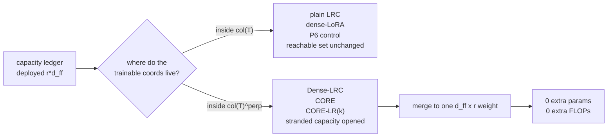
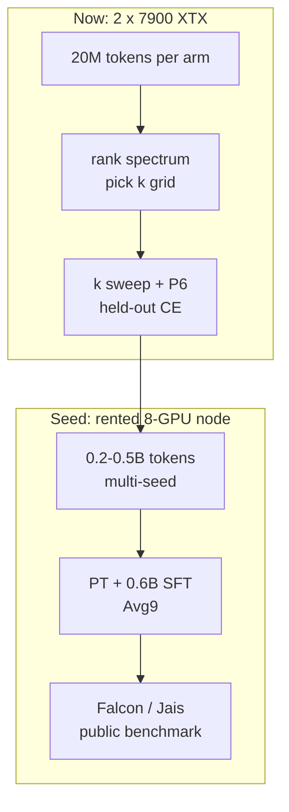

# TWYD Roadmap — Research, CORE-LR, TWYD-MoE

> Goal: turn TWYD from "paper + private code" into a reproducible, open-source, fundable technical
> asset on top of ms-swift.
> Principle: pass the step-0 gate before arguing about parameter efficiency; get a believable Pareto
> curve on small models before scaling to MoE and 10B-token budgets.

For the engineering reference see [`TECHNICAL.md`](TECHNICAL.md); for the investor narrative see
[`../README.md`](../README.md).

---

## 0. Status (October 2026)

- Paper: *Train What You Deploy* (arXiv:2609.02006) — Llama3.2-3B→1.5B at r=1536; CORE-LRC gives
  +10.45 Avg9 on Qwen2.5-3B→1.7B over the matched baseline (+6.39 same-lineage Dense).
- Implementation: `twyd/` + `_upstream/ms-swift`; `plain_lrc` / `dense_lrc` / `core_lrc` registered,
  merge/export verified, CORE-LR (rank-`k` complement) running end-to-end.
- Actual runs: `output/fw-dense-pt20M`, `output/fw-corelr-k128-pt20M` — FineWeb-Edu score≥4,
  20M tokens/arm, single 7900 XTX each.
- Historical failure: the first `dense-lora128-r1024-ddp-2gpu-100k` run started from a teacher
  top-left slice. At step 1 `token_acc=1.9e-4`; after 1368 steps 13.2%; merged CE≈11.3, token acc 0;
  all 9 tasks at chance. Root cause: no LRC warm start, attention/embedding frozen, aux inert.

## 0.1 Latest conclusions (2026-10-21)

- **Qwen Table 8 is CORE's core evidence but not teacher parity.** Qwen2.5-3B→1.7B, r=1200, ρ=5.375,
  stranded 81.4%: teacher 69.11, full CORE 10B PT 63.44, PT+SFT 63.82, Dense 10B 59.38, LRC 20B
  63.43. CORE's promise is **2× token efficiency + 10.45 over matched LRC**, not 69.11.
- **Llama is the efficiency control.** 3B→1.5B, r=1536, ρ=2.67, stranded 62.5%; the paper reports
  Dense ≈ CORE (+2.36 over plain LRC). CORE-LR's target here is "match full CORE with fewer
  coordinates", not "beat Dense".
- **Zero-PT construction from scratch still fails the gate** on 1B (slice/MLP/P/attention ridge all
  FAIL). The only validated starting point is an official width-`r` LRC base with `warm_start=base`.
- **The low-rank hypothesis is unproven.** The next decisive gate is `k ≤ 256` within 0.5 Avg9 of full
  CORE, with trainable coordinates ≤ 25% of full CORE and a real step-time / optimizer-memory win.
- **AOTriton is enough for 2048 context** on the 7900 XTX: SDPA 0.588 s/step vs flash_attn Triton
  0.643 s/step at `seq=1938`; peak is identical at 15.02 GiB with a 1B teacher. Whole-step peak is set
  by teacher/MLP/logits, not attention.
- **Fixed (2026-10-21):** `CoreLinearLoRA` used to zero-init both `A` and `B`, so `grad_norm` was
  identically 0 and CORE-LR never learned. Now `A` random / `B` zero with a regression test.
  **Every earlier CORE-LR/right-side/rank result with `grad_norm=0` must be re-run.**

## 0.2 Execution log (2026-10-21 evening)

- **Stage 1/2 launched**: two arms in parallel, same budget (20M tokens, `seq=512`, effective
  16k tokens/step, `lr=1e-4`, `T=40`, `USE_AUX=0`):
  - P1 Dense-LRC → `output/fw-dense-pt20M` (~1.8k tok/s, 8.98 s/step, 17.3 GiB)
  - P3 CORE-LR k=128 factorized + frozen column → `output/fw-corelr-k128-pt20M` (~2.5k tok/s)
- **Gate isomorphism bug (fixed).** `check_init.py` never passed `lora_mode`, so
  `--branch core --lora-rank 128` actually built Dense-LoRA (104.6M) instead of CORE-LR (71.6M).
  Defaults are now `core + freeze_col`, and the script prints
  `[adapter] ... CORE-LR modules=84, Dense-LoRA modules=0`.
- **Aux loss was silently off (fixed).** `torch.linalg.lstsq` only accepts over-determined systems on
  ROCm; with `seq×batch < r` it raised and the outer `except` swallowed it. Now over/under-determined
  paths (`lstsq` / `pinv`) + a shape guard + a one-time log line. **All earlier `lambda_aux=0.2` runs
  were effectively `aux=0`.**
- **Merge parity** (`scripts/check_merge_parity.py`): exported weights are exact (`max|ΔW|=0`), but
  the factorized training graph and the deployed merged graph differ by ~1.8% relative in bf16 logits
  (max 0.375, logit scale ≈20). → **evaluate merged checkpoints only.**
- **P6 equal-parameter control implemented** (paper §6.1): `TWYD_PERP_BASIS=col` maps the complement
  coordinates back into `col(T)` (`basis_perp = T @ A`, fixed random), so the coordinate count matches
  CORE-LR while the reachable set stays inside the teacher slice. Test:
  `test_col_completion_control_same_params_but_no_new_directions`.
- **Still missing**: factorized forward for `CoreLinear` (full CORE rebuilds `d_ff×r` every step,
  4.4× dense, 11.2 GiB of bases); `lora_lr` is not wired into the optimizer; `L_align` only covers 4
  layers of hidden MSE (no attention / MLP-intermediate terms).

## 0.3 Data pipeline (2026-10-21, critical fix)

- **`truncation_strategy=delete` silently drops data.** ms-swift deletes every sample longer than
  `max_length`; a 35M-token ultrachat PT corpus collapsed to **2,992 samples** (avg 384 tokens) at
  `max_length=512`, so "20M tokens" was really ~1.1M unique tokens repeated ~18 epochs. The pilot
  script now defaults to `TRUNC=split`: long samples become multiple `max_length` chunks (first token
  of each chunk masked), no content lost, no cross-document attention.
- **Corpus switched to the paper's data family.** From the ModelScope mirror of FineWeb-Edu
  (`CC-MAIN-2013-20/train-00000-of-00014.parquet`, 2.37 GB, 785,906 docs), `int_score>=4` yields
  **111,885 docs / 130.2M tokens**; the first **51,390 docs / 60.0M tokens** became
  `data/fineweb_edu_score4_60M.jsonl` (267 MB), i.e. **140,805 chunks of 512 tokens (59.1M tokens,
  nothing dropped)** after `split`.
- Both current arms train on that corpus: 20M tokens = 1220 steps × 16,384 ≈ 1/3 epoch.

---

## 1. Why CORE-LR and not dense-LoRA

Reachable-set accounting for Llama-3.2-3B→1.5B (`r=1536`, `H=3072`, `d_ff=8192`, `L=28`, three MLP
projections per layer):

| Variant | Trainable / projection | Total | vs deployed | Update rank |
|---|---:|---:|---:|---|
| plain LRC `T Z_col^T` | rH = 4.72M | 396M | 37.5% | ≤ r |
| Dense-LRC (full matrix) | r·d_ff = 12.58M | 1057M | 100% | full |
| CORE (full complement) | r(d_ff−H) = 7.86M | 661M | 62.5% | ≤ r |
| **CORE-LR k=128** | 0.85M | **71.6M** | **6.8%** | ≤ k |
| CORE-LR k=256 | 1.70M | 143M | 13.5% | ≤ k |
| CORE-LR k=512 | 3.41M | 286M | 27.1% | ≤ k |
| dense-LoRA k=128 | 1.25M | 105M | 9.9% | ≤ k |

1. **dense-LoRA is not the TWYD philosophy.** It trains `W0 + A B^T`; the update rank is `k < r`, so
   its reachable set is *smaller* than plain LRC's. It is PEFT on a dense weight, not an opening of the
   stranded complement.
2. **CORE-LR is TWYD-native.** `W = T Z_col^T + U_perp (A B^T)^T`; every trainable coordinate lives in
   `col(T)^⊥`; merge returns a `d_ff×r` dense matrix with zero inference overhead.
3. **At equal `k`, CORE-LR is cheaper than dense-LoRA** (`d_ff−H=5120 < d_ff=8192`) and it spends its
   coordinates on the directions the teacher has but plain LRC cannot reach.
4. **The questions that decide the thesis**: CORE-LR rank sweep, per-layer rank allocation, and an
   equal-parameter control restricted to `col(T)` (P6) — only these separate "reachable set" from
   "more parameters".



## 2. Phase 0 (1–2 weeks): make the initialization pass the gate

Acceptance (`scripts/check_init.py`): student CE ≤ 6.0; token accuracy ≥ 0.20 and ≥ 0.5× teacher;
top-1 agreement with teacher ≥ 0.30. Cosine ≥ 0.5 only with `--cos-check`, and only for slice-type
inits (a trained LRC base legitimately measures ≈0).

- [x] Paper Alg.1 / App. A.4 MLP warm start:
  - [ ] embedding SVD → `P ∈ R^{r×H}`: `build_master_P` + `project_student_with_P_` implemented
    (head-aware), but the 1B real gate still fails; disabled by default.
  - [x] per-layer greedy streaming `C^T C` / `C^T H_T`, fit the deployed `W`, split into `Z_col` /
    `Z_perp` (`scripts/calib_ridge.py`, `tests/test_ridge_calib.py`, 38 tests).
  - [x] `warm_start=ridge` (online) and `ridge_ckpt` (offline `.pt` / merged HF).
- [x] Official width-`r` LRC base wired (2026-10-21): `JitaiHao/LRC-1.5B-Base` (Llama-3.2-3B teacher,
  hidden 1536 / 24 heads / 8 kv) with `--model <LRC> --model_type llama --template llama3_2
  WARM_START=base`. The official LRC keeps the teacher's head count and only compresses the residual
  width (`q_proj (3072,1536)`, `k_proj (1024,1536)`, `o_proj (1536,3072)`).
  Measured: teacher CE 3.084 / tok_acc 0.500; student CE 3.180 / tok_acc 0.474 / agreement 0.795 → PASS.
- [x] Gate on CE + token accuracy + top-1 agreement (basis-free), not on hidden cosine.
- [x] Teacher SVD basis disk cache (`TWYD_BASIS_CACHE_DIR`, default `~/.cache/twyd/basis`):
  1.70 s → 0.02 s per projection.
- [x] Real 1.5B + 3B CORE-LR end-to-end (`K=128 FACTORIZED=1 WARM_START=base`): 71.57M trainable
  (7.03%), checkpoint is a clean dense LRC (`gate_proj (8192,1536)`, no `z_col`/`zoom` residue) and
  loads with `transformers.from_pretrained`.
- [x] Two fatal bugs (2026-10-21): teacher re-copied over PCIe every step (3.18 → 0.63 s/step after
  pinning); bf16 KL produced a negative loss (fp32 chunked KL, locked by `test_kl_numerics.py`).
- [x] `FACTORIZED=1` is the only CORE-LR shape that is not significantly slower (1.21× dense per
  layer; merged 3.67×, full CORE 4.42×).
- [ ] Real 1B from-scratch gate (2026-10-20): slice CE 11.90/cos 0.168 → MLP ridge 11.15/0.219, still
  FAIL; P select 11.95/0.146; P merge 11.76/0.171; P+ridge 15.60/0.114; P+attention ridge+MLP ridge
  15.88/0.117. **Linear MLP/P/attention ridge cannot construct a student from scratch**; attention
  semantics are the blocker. Validated path: official LRC base + `warm_start=base`.
- [ ] Attention warm start via LRC zoom/ridge (currently only MLP gate/up/down).
- [ ] If time-constrained: produce a width-`r` checkpoint with the official LowRankClone `CoTrainLM` +
  `scripts/convert_ckpt.py`, then use it as `--base` / `--pt_ckpt`.
- [ ] Pin `r=1536` (not 1024); use the 3B model (or the official 1.5B LRC ckpt), not 1B+3B.
- [ ] Logit parity gate in CI (see `scripts/check_merge_parity.py`).

## 3. Phase 1 (2–4 weeks): the CORE-LR experiment matrix

Pilot on small models first. Recommended: Llama-3.2-1B teacher → r=512/768 student, 0.2–0.5B tokens;
or 3B→1.5B (r=1536) with a 0.3B-token short run. On this repo's hardware the realistic screening budget
is 20–50M tokens per arm.

### 3.1 Arms

| ID | Parameterization | Purpose |
|---|---|---|
| P0 | plain LRC `T Z_col^T` | official baseline |
| P1 | Dense (full matrix) | paper's main method / upper bound |
| P2 | full CORE `Z⊥` (column frozen) | the *correct* reference for CORE-LR |
| P2′ | full CORE, column trainable | paper-exact realization (1.057B coordinates) |
| P3 | **CORE-LR(k)** `Z⊥=A B^T`, k=64/128/256/512 | core contribution: the efficiency frontier |
| P4 | dense-LoRA(k) | PEFT control (not TWYD-native) |
| P5 | CORE-LR + per-layer rank allocation | second contribution |
| P6 | equal-parameter control confined to `col(T)` | excludes the "just more parameters" explanation (§6.1) |

Run any of them with the same script:

```bash
# P1 Dense-LRC
BRANCH=dense K=0 LORA_MODE=dense bash scripts/train_core_lr_pilot.sh
# P2 full CORE, frozen column (the reference for G2)
BRANCH=core  K=0 FREEZE_COL=true bash scripts/train_core_lr_pilot.sh
# P3 CORE-LR(k)
BRANCH=core  K=128 LORA_MODE=core FREEZE_COL=true FACTORIZED=1 ALPHA=128 \
  bash scripts/train_core_lr_pilot.sh
# P6 equal-parameter col(T) control
BRANCH=core  K=128 LORA_MODE=core FREEZE_COL=true FACTORIZED=1 PERP_BASIS=col \
  bash scripts/train_core_lr_pilot.sh
```

### 3.2 Metrics

- Language modeling: CE / token accuracy / perplexity on a held-out shard (same batch for all arms).
- Downstream: Avg9 (ARC-E/C, LogiQA, CSQA, PIQA, WinoGrande, BoolQ, SciQ, MMLU), 0-shot, one harness
  (`lm_eval run --tasks arc_easy,arc_challenge,logiqa,commonsense_qa,piqa,winogrande,boolq,sciq,mmlu
  --num_fewshot 0`).
- Cost: trainable coordinates, optimizer state bytes, peak VRAM, s/step, merge parity.
- Structure: complement occupancy (% energy in `col(T)^⊥`), stable rank / eRank / top-k energy of
  `Z⊥`, per-layer profile.

### 3.3 Research questions

1. **Rank sweep**: k from 64 to r, plot eval vs trainable coordinates; expected knee at k≈256–512.
2. **Per-layer allocation**: score each layer/projection from calibration gradients or activation
   eRank, set `k_l ∝ score_l` under a fixed total budget, and compare with uniform rank
   (`TWYD_RANK_MAP` already supports per-module `k`).
3. **P6 equal-parameter control**: same `k`, same coordinate count, restricted to `col(T)` — verifies
   the gain comes from the reachable set, not from parameter count.
4. **Basis choice**: teacher SVD `U⊥` vs a random ambient completion vs a data-aware `P` — tests the
   paper's "the basis is not privileged" conclusion.
5. **PT vs SFT**: pre-train then SFT; never conclude from SFT-only 45M-token runs.

### 3.4 Compute reality

Current 2×7900 XTX: 20M tokens ≈ 3 h per CORE-LR arm, ≈ 5 h per Dense arm; 0.2B ≈ 25–30 h, 1B ≈ 50–60 h,
10B ≈ 500 h. Therefore:

- Phase 1 uses 20–50M-token pilots to get the shape of the curve;
- reproducing the paper's 3B→1.5B 10B-token PT needs rented A100/H100 or post-seed compute — never
  promise 10B on two cards;
- the seed deck should show the pilot Pareto curve + a rental-compute budget, not a 2-card 10B claim.



## 4. Phase 2 (6–10 weeks): TWYD-MoE

### 4.1 Setting

Start from a **MoE teacher → narrower MoE student** (keep the expert count and router), not dense→MoE:

- OLMoE-1B-7B (64 experts, top-8): runs on one node, complete community eval.
- Qwen1.5-MoE-A2.7B (60 experts, top-4): strong Chinese/multilingual coverage.
- Qwen3-30B-A3B: the public benchmark target once compute allows.

### 4.2 Research points

1. **Per-expert reachability**: every expert MLP is `d_ff×r`; measure per-expert eRank, load and
   complement energy to test whether long-tail experts have more or less stranded capacity.
2. **Router-aware CORE-LR**: `k_e ∝ load_e` or `∝ gradient_e` under a fixed total complement budget;
   compare with uniform `k`.
3. **Shared experts first**: always-active shared experts get the complement first; routed experts are
   allocated by load.
4. **Mergeable**: fold `U⊥ Z⊥^T` into each expert's `d_ff×r` weight; inference FLOPs, memory and
   routing unchanged.
5. **Router distillation**: the student router input width changes, so it needs a projection `P`;
   distill the teacher's top-k routing distribution with KL + a load-balance regularizer.
6. **Basis sharing**: storing `U⊥` per expert costs `L×E×d_ff×(d_ff−H)`; study cross-expert subspace
   overlap and share bases per expert cluster with per-expert coefficients.

### 4.3 Acceptance

- At equal parameter budget, the MoE student's Avg9 / perplexity / expert load does not degrade.
- Training memory/time acceptable for at least a 1B-class MoE pilot.
- Post-merge inference throughput matches the original width-`r` MoE.
- A "trainable coordinates per expert vs gain" curve, as the second commercial proof point.

## 5. Phase 3: productization, open source, fundraising

- **License**: enterprise plug-in + rank allocator + MoE module; compression services; subscription
  support; joint development with cloud/model vendors. Charge for delivered quality, cost saved and
  deployment value — never per training token.
- **Open source**: ms-swift plug-in, CORE-LR implementation, eval/reproduction scripts, pilot weights
  where licenses allow. Keep the data pipeline, MoE scheduling/rank allocation, eval harness and
  domain adaptation proprietary.
- **Narrative**: not "another LoRA"; rather "provable reachability + zero inference overhead +
  mergeable compression tooling".
- **Milestones**: M0 gate + pilot (1–2 months) → M1 CORE-LR Pareto (2–3 months) → M2 MoE pilot
  (4–6 months) → funding / customer POC.

## 6. This week

1. Finish the two 20M-token arms on FineWeb-Edu score≥4 and record held-out CE/token_acc.
2. Run `measure_complement_rank` on the trained full-MLP checkpoint; pick the k grid from the spectrum,
   not from intuition.
3. Add a factorized forward to `CoreLinear` so the full-CORE arm stops costing 4.4× dense.
4. Wire `TWYD_LORA_LR` into a real optimizer param group (or delete the knob).
5. Write a two-page technical memo: problem, method, Pareto curve, reproduction commands, known limits.

## 7. Company plan (wedge = CORE-LR, expansion = TWYD-MoE)

> Technology is the wedge, not the company. The company sells **the same task quality at lower
> training and deployment cost**, not "a rank formula".

### 7.1 One sentence

> **OmniReach AI lets enterprises compress Qwen/Llama-class models into deployable small models with
> fewer training coordinates and less memory; training only touches the stranded complement, and
> inference has zero overhead — extensible to MoE.**

### 7.2 Customers and wedge

1. **Private/industry model teams** with a Qwen/Llama teacher and a 1.5B–2B deployment target.
2. **Sovereign clouds and model providers** compressing many models per year (license).
3. **Edge/mobility OEMs** (robotics, vehicles, inspection) with hard latency/memory limits.
4. **MoE teams** with an existing MoE teacher who want to use expert-level stranded capacity.

First wedge: one industry + one teacher + one 1.5B–2B student + one eval suite.

### 7.3 Product shape

- **Open core**: ms-swift plug-in, CORE-LR, merge/eval/reproduction scripts (Apache-2.0 planned).
- **Commercial layer**: rank allocator (per layer / projection / expert); factorized CORE execution;
  MoE router-aware allocation; domain data/calibration/eval pipeline; enterprise support.

### 7.4 Proof points required

1. **Qwen2.5 3B→1.7B (r=1200)**: full CORE 10B PT 63.44 / PT+SFT 63.82; CORE-LR(k≤256) within 0.5;
   coordinates ≤25% of full CORE; step time or optimizer memory clearly lower.
2. **Llama 3.2 3B→1.5B (r=1536)**: CORE-LR matches Dense/full CORE with fewer coordinates, proving the
   method is not Qwen-specific.
3. **Deployment**: merged model is a plain dense width-`r` model; zero inference-framework changes;
   measured prefill/decode latency, memory and throughput.
4. **MoE pilot**: per-expert rank beats uniform rank at equal total budget; routing/output match after
   merge.

### 7.5 Business model

- License (enterprise plug-in + allocator + MoE module).
- Compression service (per model/project, including eval and deployment validation).
- Subscription/support (model upgrades, data/eval pipeline, private deployment).
- Joint development with cloud/model vendors and industry ISVs.

### 7.6 Milestones

| Horizon | Evidence |
|---|---|
| 0–90 days (pre-seed) | G0 official LRC base passes; G1 full CORE reproduces CORE>Dense on the proxy; G2 CORE-LR(k≤256) approaches full CORE; G3 factorized execution cuts step time/optimizer memory; 2 design partners |
| 3–6 months (seed) | 0.2–0.5B-token scale-up on Qwen/Llama; one customer POC (same quality, lower training cost, zero deployment overhead); MoE pilot; external users/issues/PRs |
| 6–12 months (A round) | 2–3 paying customers/LOIs; MoE compression recipe; model zoo (Qwen/Llama/domain); reproducible tokens-to-target and $/quality evidence |

## 8. Risks and Go/No-Go

| Risk | Trigger | Response |
|---|---|---|
| The low-rank hypothesis fails | `k` must be 1024–2048 to approach full CORE | ship full CORE / a structured low-rank variant instead; keep the service business |
| The Qwen teacher gap is misread | anyone reads 63.8 as "should be 69.1" | always quote "vs full CORE / 20B LRC", never vs teacher |
| Attention/embedding is the real bottleneck | per-layer cosine collapses early, complement never engages | attention zoom / LRC co-training / revisit capacity |
| Two cards are not enough | 10B tokens is infeasible locally | proxy models + paper checkpoints + rented compute |
| Data/IP provenance | corpus or weights of unclear origin | permissive data only, license audit, clean-room implementation |
| MoE distracts the main line | MoE starts before G2 | freeze MoE until G2/G3 pass |

| Gate | Criterion | Status |
|---|---|---|
| G0 init | CE ≤ 6.0, token acc ≥ 0.2 and ≥ 0.5× teacher, agreement ≥ 0.3 | **PASS** (3B → LRC-1.5B, k=128) |
| G1 full CORE | Qwen: CORE > Dense; Llama: CORE ≈ Dense | pending full-CORE arm |
| G2 low rank | k ≤ 256, within 0.5 Avg9 of full CORE, coordinates ≤ 25% | running (k=128 at 10.8% coordinates) |
| G3 cost | step time ≤ 0.9× dense or optimizer state ≤ 70% | factorized 1.21× layer cost; optimizer state 6.9% of dense |
| G4 MoE | only after G2/G3 | frozen |

### What we deliberately do not do

- build "yet another LoRA";
- promise Qwen teacher parity;
- equate "fewer parameters" with "faster inference";
- scale to MoE before dense CORE-LR is proven;
- promise 10B-token runs on two consumer cards.

## 9. Figures and references

| Figure | Source |
|---|---|
| Reachability gap (deployed matrix vs trainable slice) | [`figures/reachability_gap.tex`](figures/reachability_gap.tex) |
| CORE-LR pipeline (SVD → column + complement → merge → deploy) | [`figures/core_lr_pipeline.tex`](figures/core_lr_pipeline.tex) |

Both compile standalone with `pdflatex` and only need TikZ libraries
`arrows.meta,patterns,positioning,calc,fit,backgrounds`.

**References**

1. Hao et al. *Low-Rank Clone* (LRC). NeurIPS 2025.
2. Chen, Mao, Li, Zhou, Wang. *Train What You Deploy: Closing the MLP Reachability Gap in Low-Rank
   Clone Distillation.* arXiv:2609.02006, 2026.
3. ms-swift — ModelScope training framework (Apache-2.0).
4. FineWeb-Edu — educational-quality web text with an `int_score` field.
5. LM Evaluation Harness — 0-shot 9-task protocol used for Avg9.


