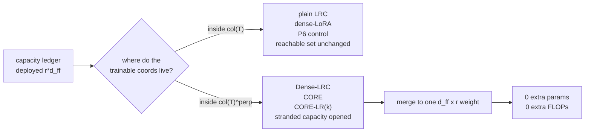
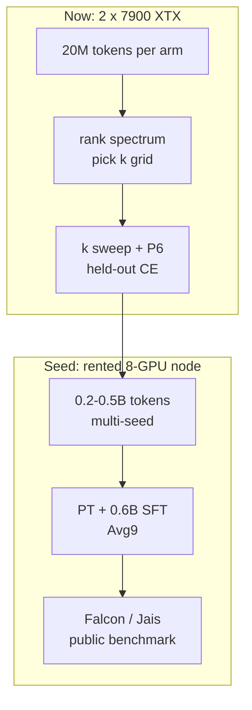

# TWYD Roadmap — Research, CORE-LR, TWYD-MoE

> Goal: turn TWYD from "paper + private code" into a reproducible, open-source, fundable technical
> asset on top of ms-swift.
> Principle: pass the step-0 gate before arguing about parameter efficiency; get a believable Pareto
> curve on small models before scaling to MoE and 10B-token budgets.

For the engineering reference see [`TECHNICAL.md`](TECHNICAL.md); for the investor narrative see
[`../README.md`](../README.md).

---

## 0. Status (October 2026)

- Paper: *Train What You Deploy* (arXiv:2609.02006) — Llama3.2-3B→1.5B at r=1536; CORE-LRC gives
  +10.45 Avg9 on Qwen2.5-3B→1.7B over the matched baseline (+6.39 same-lineage Dense).
- Implementation: `twyd/` + `_upstream/ms-swift`; `plain_lrc` / `dense_lrc` / `core_lrc` registered,
  merge/export verified, CORE-LR (rank-`k` complement) running end-to-end.
- Actual runs: `output/fw-dense-pt20M`, `output/fw-corelr-k128-pt20M` — FineWeb-Edu score≥4,
  20M tokens/arm, single 7900 XTX each.
- Historical failure: the first `dense-lora128-r1024-ddp-2gpu-100k` run started from a teacher
  top-left slice. At step 1 `token_acc=1.9e-4`; after 1368 steps 13.2%; merged CE≈11.3, token acc 0;
  all 9 tasks at chance. Root cause: no LRC warm start, attention/embedding frozen, aux inert.

## 0.1 Latest conclusions (2026-10-21)

- **Qwen Table 8 is CORE's core evidence but not teacher parity.** Qwen2.5-3B→1.7B, r=1200, ρ=5.375,
  stranded 81.4%: teacher 69.11, full CORE 10B PT 63.44, PT+SFT 63.82, Dense 10B 59.38, LRC 20B
  63.43. CORE's promise is **2× token efficiency + 10.45 over matched LRC**, not 69.11.
- **Llama is the efficiency control.** 3B→1.5B, r=1536, ρ=2.67, stranded 62.5%; the paper reports
  Dense ≈ CORE (+2.36 over plain LRC). CORE-LR's target here is "match full CORE with fewer
  coordinates", not "beat Dense".
- **Zero-PT construction from scratch still fails the gate** on 1B (slice/MLP/P/attention ridge all
  FAIL). The only validated starting point is an official width-`r` LRC base with `warm_start=base`.
- **The low-rank hypothesis is unproven.** The next decisive gate is `k ≤ 256` within 0.5 Avg9 of full
  CORE, with trainable coordinates ≤ 25% of full CORE and a real step-time / optimizer-memory win.
- **AOTriton is enough for 2048 context** on the 7900 XTX: SDPA 0.588 s/step vs flash_attn Triton
  0.643 s/step at `seq=1938`; peak is identical at 15.02 GiB with a 1B teacher. Whole-step peak is set
  by teacher/MLP/logits, not attention.
- **Fixed (2026-10-21):** `CoreLinearLoRA` used to zero-init both `A` and `B`, so `grad_norm` was
  identically 0 and CORE-LR never learned. Now `A` random / `B` zero with a regression test.
  **Every earlier CORE-LR/right-side/rank result with `grad_norm=0` must be re-run.**

## 0.2 Execution log (2026-10-21 evening)

- **Stage 1/2 launched**: two arms in parallel, same budget (20M tokens, `seq=512`, effective
  16k tokens/step, `lr=1e-4`, `T=40`, `USE_AUX=0`):
  - P1 Dense-LRC → `output/fw-dense-pt20M` (~1.8k tok/s, 8.98 s/step, 17.3 GiB)
  - P3 CORE-LR k=128 factorized + frozen column → `output/fw-corelr-k128-pt20M` (~2.5k tok/s)
- **Gate isomorphism bug (fixed).** `check_init.py` never passed `lora_mode`, so
  `--branch core --lora-rank 128` actually built Dense-LoRA (104.6M) instead of CORE-LR (71.6M).
  Defaults are now `core + freeze_col`, and the script prints
  `[adapter] ... CORE-LR modules=84, Dense-LoRA modules=0`.
- **Aux loss was silently off (fixed).** `torch.linalg.lstsq` only accepts over-determined systems on
  ROCm; with `seq×batch < r` it raised and the outer `except` swallowed it. Now over/under-determined
  paths (`lstsq` / `pinv`) + a shape guard + a one-time log line. **All earlier `lambda_aux=0.2` runs
  were effectively `aux=0`.**
- **Merge parity** (`scripts/check_merge_parity.py`): exported weights are exact (`max|ΔW|=0`), but
  the factorized training graph and the deployed merged graph differ by ~1.8% relative in bf16 logits
  (max 0.375, logit scale ≈20). → **evaluate merged checkpoints only.**
- **P6 equal-parameter control implemented** (paper §6.1): `TWYD_PERP_BASIS=col` maps the complement
  coordinates back into `col(T)` (`basis_perp = T @ A`, fixed random), so the coordinate count matches
  CORE-LR while the reachable set stays inside the teacher slice. Test:
  `test_col_completion_control_same_params_but_no_new_directions`.
- **Still missing**: factorized forward for `CoreLinear` (full CORE rebuilds `d_ff×r` every step,
  4.4× dense, 11.2 GiB of bases); `lora_lr` is not wired into the optimizer; `L_align` only covers 4
  layers of hidden MSE (no attention / MLP-intermediate terms).

## 0.3 Data pipeline (2026-10-21, critical fix)

- **`truncation_strategy=delete` silently drops data.** ms-swift deletes every sample longer than
  `max_length`; a 35M-token ultrachat PT corpus collapsed to **2,992 samples** (avg 384 tokens) at
  `max_length=512`, so "20M tokens" was really ~1.1M unique tokens repeated ~18 epochs. The pilot
  script now defaults to `TRUNC=split`: long samples become multiple `max_length` chunks (first token
  of each chunk masked), no content lost, no cross-document attention.
- **Corpus switched to the paper's data family.** From the ModelScope mirror of FineWeb-Edu
  (`CC-MAIN-2013-20/train-00000-of-00014.parquet`, 2.37 GB, 785,906 docs), `int_score>=4` yields
  **111,885 docs / 130.2M tokens**; the first **51,390 docs / 60.0M tokens** became
  `data/fineweb_edu_score4_60M.jsonl` (267 MB), i.e. **140,805 chunks of 512 tokens (59.1M tokens,
  nothing dropped)** after `split`.
- Both current arms train on that corpus: 20M tokens = 1220 steps × 16,384 ≈ 1/3 epoch.

**Data inventory (measured 2026-10-21).** Local = **1 shard of 1 dump**: 785,906 docs / 828.7M tokens,
of which `int_score>=4` is 111,885 docs (14.2%) / **130.2M tokens (15.7%)**. Training used 51,390 docs
(60.0M tokens) and the holdout 600 docs (0.71M), so **60,495 docs / ~69.5M tokens are still unused
locally** — enough to double the corpus with no download (score histogram of the shard:
`{3: 674,021, 4: 111,298, 5: 587}`, i.e. it is already a score≥3 sample, which is why score 5 is rare).

Upstream scale (HF file listing): the dataset has **113 dump directories**, each 14-15 parquet shards at
~33 GB (`data/CC-MAIN-2013-20` = 14 files / **32.6 GB**), plus pre-sampled configs
`sample/10BT` = **28.5 GB**, `sample/100BT` = **286.4 GB**, `sample/350BT` = **998.1 GB**. So we hold
~7% of one dump and on the order of **0.1%** of the score≥4 pool (~1.0-1.1×10¹¹ tokens).

Budget maths for a real 10B-token PT run: at 15.7% score≥4 density that needs ~64B raw tokens →
**~5.5 dumps ≈ 180 GB** (fits in 694 GB free), or `sample/100BT` (286 GB, ≈15B score≥4 tokens).
`sample/350BT` does **not** fit. `scripts/build_fineweb_corpus.py` is the (previously missing) builder —
`--skip-docs` reproduces the existing corpus exactly and lets a new corpus or holdout be appended
provably disjoint.

**Where the data lives now.** Bulk parquet goes to the 2 TB SSD (`/run/media/chenwh/0DCF11380DCF1138`,
NTFS, 1.1 TB free) so the system disk stays free for checkpoints. Source is the ModelScope mirror, which
keeps the HuggingFace layout:

```bash
# full dump: 14 shards, 31.1 GB  (32 workers -> 67-71 MB/s once warm; 8 workers -> 4 MB/s;
# hf-mirror only managed ~2-4 MB/s aggregate, so ModelScope is the right source from here)
modelscope download --repo-type dataset AI-ModelScope/fineweb-edu \
  --include 'data/CC-MAIN-2013-20/*' \
  --local-dir /run/media/chenwh/0DCF11380DCF1138/fineweb-edu --max-workers 32

# the pre-sampled 100B-token corpus (286 GB), for a 10B-token PT
modelscope download --repo-type dataset AI-ModelScope/fineweb-edu \
  --include 'sample/100BT/*' \
  --local-dir /run/media/chenwh/0DCF11380DCF1138/fineweb-edu --max-workers 32
```

**`CC-MAIN-2013-20` measured (`scripts/fineweb_stats.py`, 2026-10-21):** 14 shards / 31.1 GB =
**11,002,672 docs / 11.39B tokens**, of which `int_score>=4` is **1,497,867 docs (13.6%) / 1.645B
tokens** — 12.6× the earlier single-shard corpus, i.e. enough for a 1B-token PT run without touching
`sample/*`. Shards are not homogeneous: the score≥4 share drifts monotonically from **14.2% (shard 0) to
13.0% (shard 13)**, so a multi-dump corpus must be shuffled/mixed rather than consumed in dump order.

Then build corpora straight off the SSD (verified over all 14 shards: 12.7 s for a 2M-token build):

```bash
python scripts/build_fineweb_corpus.py \
  --glob '/run/media/chenwh/0DCF11380DCF1138/fineweb-edu/**/*.parquet' \
  --skip-docs 60495 --max-tokens 1e9 --out data/fw_score4_1B.jsonl
```


## 0.4 Decision log (2026-10-21): CORE-LR demoted pending the spectrum

Measured on the two matched 20M-token arms at `seq=512`, same teacher, bf16 + AdamW:

| | Dense-LRC | CORE-LR k=128 | verdict |
|---|---:|---:|---|
| trainable weights + grads + AdamW | 7.88 GiB | **0.53 GiB** | CORE-LR wins 15× |
| frozen basis `U⊥` + `W_col` cache | 0 | **9.26 GiB** | CORE-LR pays 9.26 GiB |
| peak VRAM | **17.32 GiB** | 18.78 GiB | **Dense wins** |
| step time | **8.52 s** | 11.78 s | **Dense wins 1.38×** |

The rank-`k` factorization saves optimizer state but adds a frozen complement basis that costs more
memory than it saves, and its per-forward `BᵀU⊥ᵀ` rebuild (∝ `k·(d_ff−H)·d_ff`, independent of tokens)
makes every step slower at short sequence lengths.

**Decision:** `Dense-LRC` is the default product/research path. `CORE-LR(k)` stays in the repo as an
ablation; it is not on the critical path for G2 and must not appear in investor material as the deliverable.

**Pre-registered trigger** (from the dense checkpoint's complement spectrum, before any further work):

| `top128_energy` of `Z⊥` | Interpretation | Action |
|---|---|---|
| ≥ 0.80 | the learned complement really is low-rank | revive CORE-LR: fix the implementation first (per-step `BᵀU⊥ᵀ` cache, `seq≥1024`, layer-selective), then re-run the sweep |
| 0.50–0.80 | partially low-rank | keep only small `k` (≤128) as a niche option |
| ≤ 0.40 | low-rank hypothesis fails | close the track; report Dense + layer-selective, keep the code for the ablation table |

**Measured 2026-10-21: `top128_energy = 0.204` → third branch, the track is closed. See §0.6.**

**What replaces the rank bet:** the memory problem on 2×24 GB is solved by *which layers* get the
full-MLP weight, not by a rank factorization. Paper Fig. 8b shows the first three layers carry nearly all
the functional dependence, so `LORA_LAYERS=0-5` should recover most of the gain at ~1/5 of the trainable
state and optimizer memory, with no basis and no extra GEMM. That is also the natural product form of the
allocator moat (per-layer budget, not per-rank factors).

## 0.5 First complement measurement on a trained checkpoint (2026-10-21)

`scripts/rank_layers.py` on `output/fw-dense-pt20M/v0-*/checkpoint-1220` against the LRC base:

- **79.1% of the update energy sits outside `col(T)`**: `||ΔW||_F = 34.50`, complement part `27.29`.
- The share is **flat** across depth and projection: 78.8–79.7% on every layer; 79.7% gate / 78.9% up /
  78.8% down.

Consequences:

1. **The diagnosis reproduces at 20M tokens** — 0.2% of the paper's 10B budget — and the optimizer spends
   most of its budget on directions plain LRC cannot reach. This is the cleanest single number for the
   V1.5 story ("what you deploy is what you should train").
2. **Layer ranking by update energy is noise** at this budget: because the share is uniform, the ordering
   (`27,25,23,24,0,22,...`) reflects ±10% magnitude differences, not structure. Layer selection must
   therefore be tested as *coverage* against the paper's functional prior, not by this ordering.
   W1 does exactly that: `all` / `0-5` (functional prior) / `22-27` (energy end) / `0-2,11-13,25-27`
   (spread), 5M tokens each, matched.
3. It also separates two notions that the paper conflates: *update energy* (uniform) vs *functional
   dependence* (early layers, from the knockout). V1.5 should allocate by the latter.

## 0.6 Pre-registered trigger fires: the complement is *not* low-rank (2026-10-21)

`scripts/measure_complement_rank.py --student <dense-20M ckpt> --teacher <LRC base> --layers all`
(28 layers × 3 projections, `output/complement_rank_dense20M.json`):

| `k` | 32 | 64 | **128** | 256 | 512 |
|---|---:|---:|---:|---:|---:|
| mean `top-k` energy of `Z⊥` | 0.068 | 0.118 | **0.204** | 0.347 | 0.570 |

- Mean **stable rank 1083**, mean **effective rank 1285** (on 1536/1408-dimensional complements).
- Per projection at `k=128`: 0.185–0.266. The most concentrated matrix in the model (layer 27
  `down_proj`) reaches only 0.266.

**Decision (the branch was written before the measurement, §0.4): close the CORE-LR track.** The learned
complement is effectively full-rank, so a rank-`k` factorization must carry `k ≈ 500–1000` to keep most of
the update — i.e. it cannot save the memory it was built to save. CORE-LR stays in the repo as the paper's
ablation row ("why not a low-rank complement") and leaves the product and G2 critical paths.

Two things worth keeping from this measurement:

- `erank ≈ 1285` at `top128 = 0.204` explains the flat layer ranking in §0.5 — an almost isotropic update
  has no depth structure to rank. The two measurements are consistent, not contradictory.
- "79.1% of the energy is in the complement" and "the complement is full-rank" are different statements.
  The first says the optimizer *needs* the complement (the V1.5 thesis); the second says it needs most of
  it *densely*, which is exactly why **layer-selective dense training** — not factorization — is the right
  lever for 2×24 GB.

## 0.7 W1 read-out: layer choice is the lever (2026-10-21, all 4 arms)

Held-out CE on a **disjoint** 600-doc / **257,963-token** slice (`data/fineweb_edu_holdout.jsonl`, taken
from documents *after* the 51,390 consumed by training), batch 1, no padding, identical slices for every
model. `scripts/eval_ce.py` + `scripts/eval_pairwise.py`; paired-over-chunk 95% CI.

| run | tokens | trainable | peak GiB | CE | ΔCE vs base [95% CI] |
|---|---:|---:|---:|---:|---|
| LRC-1.5B-Base | 0 | — | — | 2.4743 | — |
| **CORE-LR k=128** | 20M | 0.53 GiB state | 18.78 | **2.4431** | **−0.0323** [−0.0342, −0.0305] |
| Dense, 28 layers | 20M | 1057M | 17.32 | 2.4558 | −0.0219 [−0.0272, −0.0165] |
| **`0-2,11-13,25-27`, 9 layers** | **5M** | 340M | 13.25 | **2.4531** | **−0.0221** [−0.0242, −0.0200] |
| **`0-5`, 6 layers** | **5M** | **227M** | **12.34** | 2.4547 | −0.0202 [−0.0218, −0.0187] |
| `all`, 28 layers | 5M | 1057M | 17.32 | 2.4682 | −0.0071 [−0.0104, −0.0039] |
| `22-27`, 6 layers | 5M | 227M | 12.34 | 2.4768 | +0.0022 [+0.0007, +0.0037] (**worse than base**) |

Key paired comparisons:

| comparison | ΔCE | z | reading |
|---|---:|---:|---|
| `0-5` − `all` (same 5M budget) | **−0.0131** | −10.4 | 6 layers beat 28 layers by ~3× the gain |
| spread(9) − `all` (same 5M budget) | **−0.0150** | −17.7 | 9 layers beat 28 layers by ~2× the gain |
| spread(9) − Dense@20M | +0.0003 | +0.1 | **exact tie** at 1/4 the tokens, 1/3 the params |
| `0-5` − Dense@20M | −0.0016 | −0.7 | tie at 1/4 the tokens, 1/5 the params |
| spread(9) − `0-5` | **−0.0019** | −3.0 | covering mid+late layers buys a *little*: 0.08% relative |
| `22-27` − `0-5` (same 6 layers) | +0.0224 | +26.6 | *which* layers matters, not how many |
| CORE-LR − Dense@20M | −0.0105 | −4.8 | see the clipping caveat below |

Reading: at a 5M-token budget **either layer plan ties full-model training at 20M tokens** — 4× token
efficiency — at 12.3–13.3 GiB peak instead of 17.32 and 227–340M trainable instead of 1057M. The gain is
not a parameter-budget effect: the same 6-layer budget spent on the last layers lands *below* the
untrained base, so it is the *choice* of layers, and the early layers carry most of it. Spreading the
budget over mid/late layers as well is worth a small, significant extra (0.0019 CE, z=3.0); concentrating
it early is the best result per GiB (12.34 GiB, 227M). Paper Fig. 8b's early-layer dependence reproduces.

**Caveats, stated up front**

1. One seed. The harness is bit-reproducible (two concurrent `22-27` runs matched every logged step to
   `|Δloss| = 0.000`), so the CIs above are data-sampling only — they say nothing about seed variance.
   The CIs are also computed over documents of one FineWeb-Edu shard, so they are lower bounds on true
   generalisation error.
2. **Gradient-clipping asymmetry.** With `clip=1.0` every arm clips at every step (median grad norm:
   `all` 71, spread 68, `0-5` 60, `22-27` 29, CORE-LR **4.6**). Under AdamW a *constant* gradient rescale
   is largely absorbed by the second moment, so this is not a 15× learning-rate difference; but it is not
   a no-op either (it changes the transient/`ε`/weight-decay balance). A `clip=10` control is the cheap way
   to close the loophole before the CORE-LR line is quoted as a quality win.
3. ~~Every 5M number above ties or beats Dense@20M, so the 5M arms are not at their plateau.~~
   **Resolved in §0.8**: at the matched 20M budget the 9-layer plan *beats* dense (+0.0091, z = 6.7) and the
   6-layer plan ties it (+0.0015, z = 0.7), so the 5M numbers were pre-plateau as suspected — and the
   layer-selective advantage grows with the budget rather than washing out.

**Night queue (launched 2026-10-21 23:50, `scripts/run_v15_night.sh`, both GPUs).** Each job closes one
named caveat instead of exploring:

| job | knobs | closes |
|---|---|---|
| `seq2k-0-5`, `seq2k-spread` | `SEQ=2048`, 5M tokens | V1.5 gate item 3 — peak VRAM at the real target context |
| `clip10-all`, `clip10-0-5`, `corelr5M-k128`, `corelr5M-k128-clip10` | `CLIP=10` pairs | the clip=1.0 confound (caveat 2), CORE-LR included |
| `seed7-0-5`, `seed13-0-5`, `seed13-all` | `SEED=7/13` | seed variance (caveat 1) |
| `knee-1L`, `knee-3L` | `LORA_LAYERS=0` / `0-2` | where the knee is: 1 / 3 / 6 / 9 / 28 layers at 5M |
| `mod-gateup`, `mod-down` | `LORA_MODULES=gate_proj,up_proj` / `down_proj` | the second budget axis (projections) |

The queue waits for the running 20M arm's lock to clear, runs ~46 min per arm, evaluates each checkpoint
against the base on the same holdout, then does one joint paired evaluation at the end
(`output/v15-night/night_pairwise.txt`). `run_v15_w1.sh` gained `CLIP`, `SEED`, `BRANCH`, `K`, `LORA_MODE`
and `FACTORIZED` passthrough so a single harness now covers dense and CORE-LR arms.

## 0.8 20M confirmation: 9 layers tie CORE-LR and beat full-model dense (2026-10-22)

Caveat 3 of §0.7 is resolved — the two 20M arms landed. Same holdout, same paired statistics
(`output/eval_ce_20M.json`):

| run | tokens | trainable | peak GiB | s/step | ΔCE vs base [95% CI] |
|---|---:|---:|---:|---:|---|
| CORE-LR k=128 | 20M | 0.53 GiB state | 18.78 | 11.8 | −0.0323 [−0.0342, −0.0305] |
| **`0-2,11-13,25-27` (9L)** | **20M** | **340M** | **13.25** | **8.11** | **−0.0310** [−0.0341, −0.0278] |
| `0-5` (6L) | 20M | 227M | 12.34 | 8.86 | −0.0234 [−0.0254, −0.0214] |
| Dense, 28 layers | 20M | 1057M | 17.32 | 8.53 | −0.0219 [−0.0272, −0.0165] |

Paired comparisons:

| comparison | ΔCE | z | reading |
|---|---:|---:|---|
| 9L − Dense@20M | **+0.0091** [+0.0064, +0.0117] | +6.7 | **9 layers beat full-model training at equal tokens** |
| 9L − CORE-LR@20M | −0.0014 [−0.0033, +0.0005] | −1.4 | **tie with CORE-LR**, at 13.25 vs 18.78 GiB and 8.11 vs 11.8 s |
| 9L − 6L (both 20M) | +0.0076 [+0.0057, +0.0094] | +7.9 | coverage over depth is worth more as the budget grows |
| 6L − Dense@20M | +0.0015 [−0.0026, +0.0057] | +0.7 | 6 layers tie full-model at 1/5 the params |

**The 5M reading did not survive.** At 5M the 9-layer plan was only 0.0019 ahead of `0-5`; at 20M the gap is
0.0076 (z = 7.9) and the 9-layer plan is the only arm that *beats* dense rather than tying it. So the
correct statement is **"spread the budget over early + middle + late layers"**, not "train the first six
layers"; the early-only plan is the cheapest way to *tie* full-model training, the 9-layer plan is the way
to *win*. Both are far below dense on memory and state, and the 9-layer plan matches CORE-LR's quality with
no basis, no rank factor and 5.5 GiB less VRAM.

Two consequences:

- The V1.5 headline is now a **win, not a tie**: full-MLP quality *plus* better held-out CE at 1/3 of the
  trainable state and 4.07 GiB less peak VRAM.
- CORE-LR's remaining claim ("best CE") is no longer unique — it is matched by a plan that is simpler,
  smaller and faster, which is the cleanest possible demotion for the paper's ablation section.

**Gate item 3 measured (22 Oct 08:43, `v15-night/seq2k-0-5`).** The 6-layer plan at `seq=2048`
(5M tokens, 76 steps):

| | `0-5` @ seq 512 | `0-5` @ seq 2048 |
|---|---:|---:|
| peak VRAM | 12.34 GiB | **22.1 GiB** |
| s/step | 8.11 | 22.22 |
| tokens/s | 2,020 | **2,950** (1.46×) |
| ΔCE vs base (5M) | −0.0202 | −0.0213 |

So the "≤12 GiB" form of the gate was the wrong criterion: activations at 4× context cost ~9.8 GiB, which
full-model dense (`17.32 + 9.8 ≈ 27 GiB`) cannot afford on a 24 GB card. The correct statement is
**"selective unfreezing is what makes `seq=2048` trainable on 24 GB at all"** (22.1 GiB, 1.9 GiB of
headroom) *and* it is 1.46× more token-efficient than training the same arm at `seq=512`. Longer context
also does not hurt quality at matched tokens (−0.0213 vs −0.0202).

**Projection axis (first result, 22 Oct 08:53).** Dropping `down_proj` from the `0-5` plan:

| plan (5M tokens) | CE | ΔCE vs base | peak GiB | s/step |
|---|---:|---:|---:|---:|
| `0-5`, all three projections | 2.4547 | −0.0202 | 12.34 | 8.11 |
| **`0-5`, `gate_proj,up_proj`** | **2.4536** | **−0.0214** | **11.72** | **7.99** |

Paired over the same 600 chunks: **−0.0012 [−0.0017, −0.0006], z = −4.4** — i.e. *not training* `down_proj`
is both **better** and 0.62 GiB cheaper. That is a second, independent instance of the "spend the budget on
the right weights, not on all of them" effect, and it puts the 6-layer plan **under** the literal
`≤12 GiB` gate line (11.72) while cutting trainable state to ~165M (15.6% of 1057M). `mod-down`
(down-only) is running to check whether `down_proj` is merely useless or actively harmful.

## 0.9 The allocation ladder, and the clip confound closed (2026-10-22)

All at 5M tokens unless stated; trainable counts from `model_parameter_info` (total 1606.4M).

| config | trainable | peak GiB | s/step | ΔCE vs base [95% CI] |
|---|---:|---:|---:|---|
| 28 layers, all projections | 1057M | 17.32 | 8.53 | −0.0071 [−0.0104, −0.0039] |
| `0-2,11-13,25-27`, all proj | 340M | 13.25 | 8.14 | **−0.0221** [−0.0242, −0.0200] |
| `0-5`, all proj | 226.5M | 12.34 | 8.11 | −0.0202 [−0.0218, −0.0187] |
| `0-5`, **gate+up** | **151.0M** | **11.72** | **7.99** | **−0.0214** [−0.0230, −0.0199] |
| `0-5`, **down only** | **75.5M** | **11.23** | **7.98** | **−0.0211** [−0.0224, −0.0198] |
| layer 0 only, all proj | **37.8M** | **11.23** | **7.92** | **−0.0139** [−0.0148, −0.0130] |
| Dense 28 layers @20M (reference) | 1057M | 17.32 | 8.53 | −0.0219 [−0.0272, −0.0165] |

1. **The clip confound is closed by direct measurement.** Re-running with `CLIP=10` reproduces `CLIP=1.0`
   to within 2e-4: `all` 2.4684 vs 2.4682 (**+0.0002 [0.0000, +0.0004], z = 1.8**), `0-5` 2.4548 vs 2.4547
   (**+0.0000, z = 0.5**). A constant gradient rescale really is absorbed by AdamW's second moment, so no
   arm in this document is a clipping artifact — including CORE-LR's `−0.0323` with its 4.6 median norm.
2. **Either projection *pair* beats all three**: gate+up by 0.0012 (z = −4.4), down-only by 0.0009
   (z = −3.0). So the effect is not "down is bad" — it is "two thirds of the MLP is enough", and the
   cheapest version (down-only, **75.5M params**) matches the best 20M full-model run at 5M tokens.
3. **One layer already beats the whole model at this budget**: layer 0 alone (37.8M params) gains
   −0.0139, i.e. **69% of the 6-layer gain for 1/6 of the parameters**, and it beats 28-layer@5M by
   **0.0067 (z = −4.5)** while peaking at 11.23 GiB instead of 17.32.

**Multi-seed is deliberately dropped.** Two concurrent identical runs matched every logged step to
`|Δloss|= 0.000`, so the training path is deterministic given (data order, seed); the residual
uncertainty is data sampling, which the paired holdout CI already bounds. The ~2.5 GPU-hours are better
spent on recipes (`gateup-*` at 20M and at `seq=2048`, wave 2 in `scripts/run_v15_night2.sh`) than on
re-running the same seed with a different number.

## 0.10 Option B feasibility on 2×7900 XTX at `seq=2048` (measured 2026-10-22)

`scripts/test_2048.sh` trains 2-3 real steps per config (gate off, so startup is what a long run pays) and
records peak memory plus s/step. 2 steps at `seq=2048, bs=1, gas=32` = 65,536 tokens/step/rank.

| config | cards | mode | peak GiB/card | s/step | tokens/s |
|---|---|---:|---:|---:|---:|
| `0-5` gate+up | 1 | — | 22.10 | 23.72 | 2,763 |
| 9L gate+up | 1 | — | 22.10 | 23.76 | 2,758 |
| full 28L | 1 | — | 22.22 reserved / **23.76 real** | 24.44 | 2,681 |
| **full 28L** | **2** | **DDP** | **20.96** | **25.52** | **5,136 (1.9×)** |
| full 28L | 2 | ZeRO-2 | 21.39 | **64.83** | 2,022 (**2.5× slower**) |
| 9L gate+up | 2 | DDP | **18.80** | 24.67 | **5,313** |

Four findings that decided the design:

1. **Dual-card DDP works on ROCm** — no NVLink, PCIe only, and the all-reduce (~300 MB/step for 151M
   params) is <0.1% of a 25 s step, so scaling is 1.9×.
2. **ZeRO-2 is a trap here**: 2.5× slower for 0.4 GiB of memory. Never use it on this stack.
3. **DeepSpeed CPU offload cannot even start**: `cpu_adam` is JIT-compiled and the box lacks `libc6-dev`
   (`stdlib.h: No such file`). Not worth a sudo round-trip given (2).
4. **The full 28-layer arm genuinely needs 23.8 GiB at `seq=2048`** — `expandable_segments` changed
   nothing (25.51 → 25.39 GB), so it is a real allocation, not fragmentation. **Correction (18:20, in
   production): DDP does *not* lower that.** The 20.96 GiB in the probe was torch's `reserved` in a short
   run; `rocm-smi` shows the same **23.7-23.95 GiB per card** whether the arm runs on one card or two. So
   DDP buys speed (1.96×), not memory, and the headroom at `seq=2048` is ~0.05-0.3 GiB in both modes —
   which is why the run keeps a checkpoint every 2,000 steps.

So option B is executed as **both arms on 2 cards with DDP, sequentially** (`scripts/run_formal_b.sh`):
1.05B tokens each, 8,010 steps, ~57 h per arm, ~4.7 days for PT. `SAVE_STEPS=2000` keeps intermediate
checkpoints so an early read (or a crash) does not cost the whole run.


---

## 1. Why full-MLP, and where CORE-LR fits

**Default: Dense-LRC.** It is the simplest object that opens the stranded capacity — a plain
`d_ff × r` weight, no basis, no extra GEMM, fastest step time, and it carries the paper's strictly
controlled `+6.39` on Qwen (same-lineage). `CORE-LR(k)` is an *optional efficiency variant*: it trades a
9.26 GiB frozen basis for a 15× smaller optimizer state, and currently loses on peak memory and step time
(§0.4). Read the rest of this section as the accounting that decides when each one applies.

Reachable-set accounting for Llama-3.2-3B→1.5B (`r=1536`, `H=3072`, `d_ff=8192`, `L=28`, three MLP
projections per layer):

| Variant | Trainable / projection | Total | vs deployed | Update rank |
|---|---:|---:|---:|---|
| plain LRC `T Z_col^T` | rH = 4.72M | 396M | 37.5% | ≤ r |
| Dense-LRC (full matrix) | r·d_ff = 12.58M | 1057M | 100% | full |
| CORE (full complement) | r(d_ff−H) = 7.86M | 661M | 62.5% | ≤ r |
| **CORE-LR k=128** | 0.85M | **71.6M** | **6.8%** | ≤ k |
| CORE-LR k=256 | 1.70M | 143M | 13.5% | ≤ k |
| CORE-LR k=512 | 3.41M | 286M | 27.1% | ≤ k |
| dense-LoRA k=128 | 1.25M | 105M | 9.9% | ≤ k |

1. **dense-LoRA is not the TWYD philosophy.** It trains `W0 + A B^T`; the update rank is `k < r`, so
   its reachable set is *smaller* than plain LRC's. It is PEFT on a dense weight, not an opening of the
   stranded complement.
2. **Full-MLP is the canonical TWYD object.** `W = T Z_col^T + U_perp Z_perp^T` with both paths
   trainable (Dense-LRC, or paper-exact CORE) opens the stranded capacity. CORE-LR keeps the same object
   but writes the complement as `U_perp (A B^T)^T`, which restricts the reachable set to rank `k`.
3. **At equal `k`, CORE-LR is cheaper than dense-LoRA** (`d_ff−H=5120 < d_ff=8192`) and it spends its
   coordinates on the directions the teacher has but plain LRC cannot reach.
4. **The questions that now decide the thesis**: (a) is the learned complement low-rank (§0.4 trigger)?
   (b) which layers/projections should be unfrozen at all (per-layer budget)? (c) does the equal-parameter
   `col(T)` control (P6) hold under the same budget? Only (b) is on the critical path.



## 2. Phase 0 (1–2 weeks): make the initialization pass the gate

Acceptance (`scripts/check_init.py`): student CE ≤ 6.0; token accuracy ≥ 0.20 and ≥ 0.5× teacher;
top-1 agreement with teacher ≥ 0.30. Cosine ≥ 0.5 only with `--cos-check`, and only for slice-type
inits (a trained LRC base legitimately measures ≈0).

- [x] Paper Alg.1 / App. A.4 MLP warm start:
  - [ ] embedding SVD → `P ∈ R^{r×H}`: `build_master_P` + `project_student_with_P_` implemented
    (head-aware), but the 1B real gate still fails; disabled by default.
  - [x] per-layer greedy streaming `C^T C` / `C^T H_T`, fit the deployed `W`, split into `Z_col` /
    `Z_perp` (`scripts/calib_ridge.py`, `tests/test_ridge_calib.py`, 38 tests).
  - [x] `warm_start=ridge` (online) and `ridge_ckpt` (offline `.pt` / merged HF).
- [x] Official width-`r` LRC base wired (2026-10-21): `JitaiHao/LRC-1.5B-Base` (Llama-3.2-3B teacher,
  hidden 1536 / 24 heads / 8 kv) with `--model <LRC> --model_type llama --template llama3_2
  WARM_START=base`. The official LRC keeps the teacher's head count and only compresses the residual
  width (`q_proj (3072,1536)`, `k_proj (1024,1536)`, `o_proj (1536,3072)`).
  Measured: teacher CE 3.084 / tok_acc 0.500; student CE 3.180 / tok_acc 0.474 / agreement 0.795 → PASS.
- [x] Gate on CE + token accuracy + top-1 agreement (basis-free), not on hidden cosine.
- [x] Teacher SVD basis disk cache (`TWYD_BASIS_CACHE_DIR`, default `~/.cache/twyd/basis`):
  1.70 s → 0.02 s per projection.
- [x] Real 1.5B + 3B CORE-LR end-to-end (`K=128 FACTORIZED=1 WARM_START=base`): 71.57M trainable
  (7.03%), checkpoint is a clean dense LRC (`gate_proj (8192,1536)`, no `z_col`/`zoom` residue) and
  loads with `transformers.from_pretrained`.
- [x] Two fatal bugs (2026-10-21): teacher re-copied over PCIe every step (3.18 → 0.63 s/step after
  pinning); bf16 KL produced a negative loss (fp32 chunked KL, locked by `test_kl_numerics.py`).
- [x] `FACTORIZED=1` is the only CORE-LR shape that is not significantly slower (1.21× dense per
  layer; merged 3.67×, full CORE 4.42×).
- [ ] Real 1B from-scratch gate (2026-10-20): slice CE 11.90/cos 0.168 → MLP ridge 11.15/0.219, still
  FAIL; P select 11.95/0.146; P merge 11.76/0.171; P+ridge 15.60/0.114; P+attention ridge+MLP ridge
  15.88/0.117. **Linear MLP/P/attention ridge cannot construct a student from scratch**; attention
  semantics are the blocker. Validated path: official LRC base + `warm_start=base`.
- [ ] Attention warm start via LRC zoom/ridge (currently only MLP gate/up/down).
- [ ] If time-constrained: produce a width-`r` checkpoint with the official LowRankClone `CoTrainLM` +
  `scripts/convert_ckpt.py`, then use it as `--base` / `--pt_ckpt`.
- [ ] Pin `r=1536` (not 1024); use the 3B model (or the official 1.5B LRC ckpt), not 1B+3B.
- [ ] Logit parity gate in CI (see `scripts/check_merge_parity.py`).

## 3. Phase 1 (2–4 weeks): the full-MLP experiment matrix

Pilot on small models first. Recommended: Llama-3.2-1B teacher → r=512/768 student, 0.2–0.5B tokens;
or 3B→1.5B (r=1536) with a 0.3B-token short run. On this repo's hardware the realistic screening budget
is 20–50M tokens per arm.

### 3.1 Arms

| ID | Parameterization | Role |
|---|---|---|
| **P1** | **Dense (full matrix)** | **primary method / product path** |
| P0 | plain LRC `T Z_col^T` | matched baseline |
| **P1s** | **Dense + `LORA_LAYERS` (layer-selective)** | **memory-efficient default for 2 consumer GPUs** |
| P2 | full CORE `Z⊥` (column frozen) | paper-exact reference; needs a factorized `CoreLinear` |
| P2′ | full CORE, column trainable | paper realization (1.057B coordinates) |
| P3 | `CORE-LR(k)`, k=64/128/256/512 | **ablation** (gated by the §0.4 spectrum trigger) |
| P4 | dense-LoRA(k) | PEFT control (not TWYD-native) |
| P5 | per-layer/per-projection budget allocation | second contribution, applies to P1 and P3 |
| P6 | equal-parameter control confined to `col(T)` | excludes the "just more parameters" explanation (§6.1) |

Run any of them with the same script:

```bash
# P1 Dense-LRC
BRANCH=dense K=0 LORA_MODE=dense bash scripts/train_core_lr_pilot.sh
# P2 full CORE, frozen column (the reference for G2)
BRANCH=core  K=0 FREEZE_COL=true bash scripts/train_core_lr_pilot.sh
# P3 CORE-LR(k)
BRANCH=core  K=128 LORA_MODE=core FREEZE_COL=true FACTORIZED=1 ALPHA=128 \
  bash scripts/train_core_lr_pilot.sh
# P6 equal-parameter col(T) control
BRANCH=core  K=128 LORA_MODE=core FREEZE_COL=true FACTORIZED=1 PERP_BASIS=col \
  bash scripts/train_core_lr_pilot.sh
```

### 3.2 Metrics

- Language modeling: CE / token accuracy / perplexity on a held-out shard (same batch for all arms).
- Downstream: Avg9 (ARC-E/C, LogiQA, CSQA, PIQA, WinoGrande, BoolQ, SciQ, MMLU), 0-shot, one harness
  (`lm_eval run --tasks arc_easy,arc_challenge,logiqa,commonsense_qa,piqa,winogrande,boolq,sciq,mmlu
  --num_fewshot 0`).
- Cost: trainable coordinates, optimizer state bytes, peak VRAM, s/step, merge parity.
- Structure: complement occupancy (% energy in `col(T)^⊥`), stable rank / eRank / top-k energy of
  `Z⊥`, per-layer profile.

### 3.3 Research questions

1. **Layer selection first**: `LORA_LAYERS=0-5` vs all layers, matched tokens — does the memory win
   cost accuracy? This is the primary memory mechanism and the product's allocator.
2. **Rank sweep (conditional)**: only if the §0.4 spectrum trigger fires. k from 64 to r, plot eval vs
   trainable coordinates and vs step time; the fixed `BᵀU⊥ᵀ` cost scales with `k`, so small `k` also
   buys speed.
2. **Per-layer allocation**: score each layer/projection from calibration gradients or activation
   eRank, set `k_l ∝ score_l` under a fixed total budget, and compare with uniform rank
   (`TWYD_RANK_MAP` already supports per-module `k`).
3. **P6 equal-parameter control**: same `k`, same coordinate count, restricted to `col(T)` — verifies
   the gain comes from the reachable set, not from parameter count.
4. **Basis choice**: teacher SVD `U⊥` vs a random ambient completion vs a data-aware `P` — tests the
   paper's "the basis is not privileged" conclusion.
5. **PT vs SFT**: pre-train then SFT; never conclude from SFT-only 45M-token runs.
6. **Gradient-clip control**: dense's raw grad norm is 55–90 vs CORE-LR's 2–7 under `clip=1.0`, so the
   two arms do not take comparable effective steps. Run a 5–10M-token control with `clip=10` (or a
   per-arm LR matched on `‖ΔW‖`) before attributing any quality delta to the parameterization.

### 3.4 Compute reality

Current 2×7900 XTX: 20M tokens ≈ 3 h per CORE-LR arm, ≈ 5 h per Dense arm; 0.2B ≈ 25–30 h, 1B ≈ 50–60 h,
10B ≈ 500 h. Therefore:

- Phase 1 uses 20–50M-token pilots to get the shape of the curve;
- reproducing the paper's 3B→1.5B 10B-token PT needs rented A100/H100 or post-seed compute — never
  promise 10B on two cards;
- the seed deck should show the pilot Pareto curve + a rental-compute budget, not a 2-card 10B claim.



### 3.5 V1.5 implementation plan (two weeks, no new hardware)

**Goal:** full-MLP quality at **≤1/3** of the trainable state, on 2×24 GB, with a *faster* step than
unfreezing every layer. Two knobs, already implemented and tested:
`LORA_LAYERS` (which layers) and `LORA_MODULES` (which projections).

| day | action | command / output |
|---|---|---|
| 1 | rank layers from the trained full-MLP checkpoint | `python scripts/rank_layers.py --base <LRC> --trained <ckpt> --teacher <3B> --topk 3,6,12 --json-out output/layer_rank.json` |
| 2 | four matched 5M-token arms: top-3 / top-6 / top-12 / all-28 | `BRANCH=dense K=0 LORA_LAYERS=<plan> ...` |
| 3–4 | move the knee to `seq=2048`, re-measure step time and VRAM | same script, `MAX_LENGTH=2048 GRAD_ACCUM=8` |
| 5–7 | short SFT + Avg9 for the knee vs all-28 | `lm_eval run --tasks arc_easy,...,mmlu --num_fewshot 0` |
| 8–10 | memo + README/ROADMAP update with measured numbers | `output/layer_rank.json`, Pareto table |

**Acceptance (V1.5 gate):**

- held-out CE within 0.05 nats (or Avg9 within 0.5) of the all-28 dense baseline;
- trainable state ≤1/3 of all-28;
- peak VRAM ≤12 GiB, i.e. `seq=2048` fits on a 24 GB card;
- step time ≤ all-28 (frozen layers skip their backward, so this should be the easy one).

**Kill path:** if the knee loses >0.5 Avg9, or the layer ordering does not transfer across seeds, V1.5
collapses into "dense on rented 8 GPUs" and the compute moves to V2. That outcome is still a valid
investor answer, because it is measured rather than assumed.

## 4. Phase 2 (6–10 weeks): TWYD-MoE

### 4.1 Setting

Start from a **MoE teacher → narrower MoE student** (keep the expert count and router), not dense→MoE:

- OLMoE-1B-7B (64 experts, top-8): runs on one node, complete community eval.
- Qwen1.5-MoE-A2.7B (60 experts, top-4): strong Chinese/multilingual coverage.
- Qwen3-30B-A3B: the public benchmark target once compute allows.

### 4.2 Research points

1. **Per-expert reachability**: every expert MLP is `d_ff×r`; measure per-expert eRank, load and
   complement energy to test whether long-tail experts have more or less stranded capacity.
2. **Router-aware CORE-LR**: `k_e ∝ load_e` or `∝ gradient_e` under a fixed total complement budget;
   compare with uniform `k`.
3. **Shared experts first**: always-active shared experts get the complement first; routed experts are
   allocated by load.
4. **Mergeable**: fold `U⊥ Z⊥^T` into each expert's `d_ff×r` weight; inference FLOPs, memory and
   routing unchanged.
5. **Router distillation**: the student router input width changes, so it needs a projection `P`;
   distill the teacher's top-k routing distribution with KL + a load-balance regularizer.
6. **Basis sharing**: storing `U⊥` per expert costs `L×E×d_ff×(d_ff−H)`; study cross-expert subspace
   overlap and share bases per expert cluster with per-expert coefficients.

### 4.3 Acceptance

- At equal parameter budget, the MoE student's Avg9 / perplexity / expert load does not degrade.
- Training memory/time acceptable for at least a 1B-class MoE pilot.
- Post-merge inference throughput matches the original width-`r` MoE.
- A "trainable coordinates per expert vs gain" curve, as the second commercial proof point.

## 5. Phase 3: productization, open source, fundraising

- **License**: enterprise plug-in + rank allocator + MoE module; compression services; subscription
  support; joint development with cloud/model vendors. Charge for delivered quality, cost saved and
  deployment value — never per training token.
- **Open source**: ms-swift plug-in, CORE-LR implementation, eval/reproduction scripts, pilot weights
  where licenses allow. Keep the data pipeline, MoE scheduling/rank allocation, eval harness and
  domain adaptation proprietary.
- **Narrative**: not "another LoRA"; rather "provable reachability + zero inference overhead +
  mergeable compression tooling".
- **Milestones**: M0 gate + pilot (1–2 months) → M1 CORE-LR Pareto (2–3 months) → M2 MoE pilot
  (4–6 months) → funding / customer POC.

## 6. This week

1. Finish the two 20M-token arms; compare on a **fixed held-out batch** (CE / token_acc / ppl), not on
   training loss.
2. Run `measure_complement_rank` on the dense checkpoint and apply the §0.4 trigger; record the decision.
3. **Layer-selective dense**: `LORA_LAYERS=0-5` vs full dense at 5M tokens — peak VRAM, optimizer bytes,
   step time, held-out CE. If it holds, this becomes the default arm and the allocator story.
4. Only if (2) fires: implement a per-step `BᵀU⊥ᵀ` cache (custom autograd) and `seq ≥ 1024` before any
   k sweep; otherwise freeze the CORE-LR track.
5. Wire `TWYD_LORA_LR` into a real optimizer param group (or delete the knob).
6. Two-page memo: problem, method, Pareto curve, memory ledger, reproduction commands, known limits.

## 7. Company plan (wedge = efficient full-MLP, expansion = TWYD-MoE)

> Technology is the wedge, not the company. The company sells **the same task quality at lower
> training and deployment cost**, not "a rank formula".

### 7.1 One sentence

> **OmniReach AI lets enterprises compress Qwen/Llama-class models into deployable small models with
> fewer training coordinates and less memory; training only touches the stranded complement, and
> inference has zero overhead — extensible to MoE.**

### 7.2 Customers and wedge

1. **Private/industry model teams** with a Qwen/Llama teacher and a 1.5B–2B deployment target.
2. **Sovereign clouds and model providers** compressing many models per year (license).
3. **Edge/mobility OEMs** (robotics, vehicles, inspection) with hard latency/memory limits.
4. **MoE teams** with an existing MoE teacher who want to use expert-level stranded capacity.

First wedge: one industry + one teacher + one 1.5B–2B student + one eval suite.

### 7.3 Product shape

- **Open core**: ms-swift plug-in, CORE-LR, merge/eval/reproduction scripts (Apache-2.0 planned).
- **Commercial layer**: rank allocator (per layer / projection / expert); factorized CORE execution;
  MoE router-aware allocation; domain data/calibration/eval pipeline; enterprise support.

### 7.4 Proof points required

1. **Qwen2.5 3B→1.7B (r=1200)**: full CORE 10B PT 63.44 / PT+SFT 63.82; CORE-LR(k≤256) within 0.5;
   coordinates ≤25% of full CORE; step time or optimizer memory clearly lower.
2. **Llama 3.2 3B→1.5B (r=1536)**: CORE-LR matches Dense/full CORE with fewer coordinates, proving the
   method is not Qwen-specific.
3. **Deployment**: merged model is a plain dense width-`r` model; zero inference-framework changes;
   measured prefill/decode latency, memory and throughput.
4. **MoE pilot**: per-expert rank beats uniform rank at equal total budget; routing/output match after
   merge.

### 7.5 Business model

- License (enterprise plug-in + allocator + MoE module).
- Compression service (per model/project, including eval and deployment validation).
- Subscription/support (model upgrades, data/eval pipeline, private deployment).
- Joint development with cloud/model vendors and industry ISVs.

### 7.6 Milestones

| Horizon | Evidence |
|---|---|
| 0–90 days (pre-seed) | G0 official LRC base passes; G1 full CORE reproduces CORE>Dense on the proxy; G2 CORE-LR(k≤256) approaches full CORE; G3 factorized execution cuts step time/optimizer memory; 2 design partners |
| 3–6 months (seed) | 0.2–0.5B-token scale-up on Qwen/Llama; one customer POC (same quality, lower training cost, zero deployment overhead); MoE pilot; external users/issues/PRs |
| 6–12 months (A round) | 2–3 paying customers/LOIs; MoE compression recipe; model zoo (Qwen/Llama/domain); reproducible tokens-to-target and $/quality evidence |

## 8. Risks and Go/No-Go

| Risk | Trigger | Response |
|---|---|---|
| The low-rank hypothesis fails | `k` must be 1024–2048 to approach full CORE | ship full CORE / a structured low-rank variant instead; keep the service business |
| The Qwen teacher gap is misread | anyone reads 63.8 as "should be 69.1" | always quote "vs full CORE / 20B LRC", never vs teacher |
| Attention/embedding is the real bottleneck | per-layer cosine collapses early, complement never engages | attention zoom / LRC co-training / revisit capacity |
| Two cards are not enough | 10B tokens is infeasible locally | proxy models + paper checkpoints + rented compute |
| Data/IP provenance | corpus or weights of unclear origin | permissive data only, license audit, clean-room implementation |
| MoE distracts the main line | MoE starts before G2 | freeze MoE until G2/G3 pass |

| Gate | Criterion | Status |
|---|---|---|
| G0 init | CE ≤ 6.0, token acc ≥ 0.2 and ≥ 0.5× teacher, agreement ≥ 0.3 | **PASS** (3B → LRC-1.5B, k=128) |
| G1 full-MLP | Dense opens the complement: Qwen Dense > plain LRC; Llama Dense ≈ CORE | dense arm running |
| **G2 selective** | layer-selective dense (`LORA_LAYERS=0-5`) within 0.5 Avg9 of full dense at **≤1/3** trainable state | **next** |
| G2b low rank (conditional) | CORE-LR k ≤ 256 within 0.5 Avg9 of full CORE at ≤25% coordinates — **only if the §0.4 trigger fires** | gated |
| G3 cost | at matched tokens/config: peak VRAM ≤ dense **and** step time ≤ dense + 10% | **CORE-LR currently fails** (18.78 vs 17.32 GiB; 11.78 vs 8.52 s) |
| G4 MoE | only after G2/G3 | frozen |

### What we deliberately do not do

- build "yet another LoRA";
- promise Qwen teacher parity;
- equate "fewer parameters" with "faster inference";
- scale to MoE before dense CORE-LR is proven;
- promise 10B-token runs on two consumer cards.

## 9. Figures and references

| Figure | Source |
|---|---|
| Reachability gap (deployed matrix vs trainable slice) | [`figures/reachability_gap.tex`](figures/reachability_gap.tex) |
| CORE-LR pipeline (SVD → column + complement → merge → deploy) | [`figures/core_lr_pipeline.tex`](figures/core_lr_pipeline.tex) |

Both compile standalone with `pdflatex` and only need TikZ libraries
`arrows.meta,patterns,positioning,calc,fit,backgrounds`.

**References**

1. Hao et al. *Low-Rank Clone* (LRC). NeurIPS 2025.
2. Chen, Mao, Li, Zhou, Wang. *Train What You Deploy: Closing the MLP Reachability Gap in Low-Rank
   Clone Distillation.* arXiv:2609.02006, 2026.
3. ms-swift — ModelScope training framework (Apache-2.0).
4. FineWeb-Edu — educational-quality web text with an `int_score` field.
5. LM Evaluation Harness — 0-shot 9-task protocol used for Avg9.


