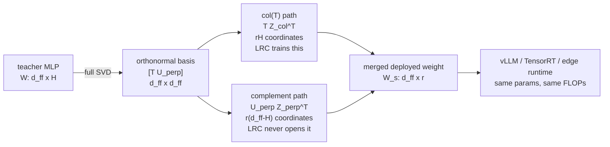
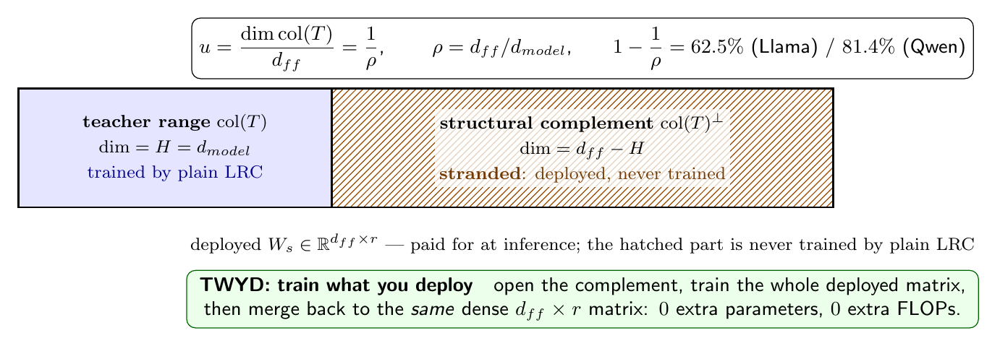
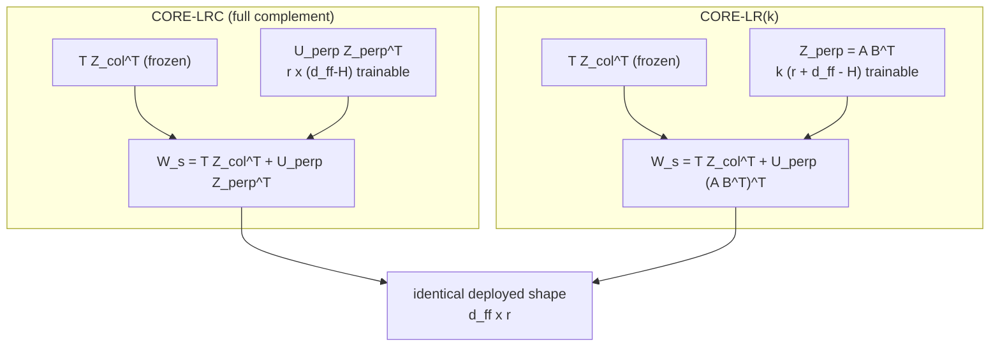
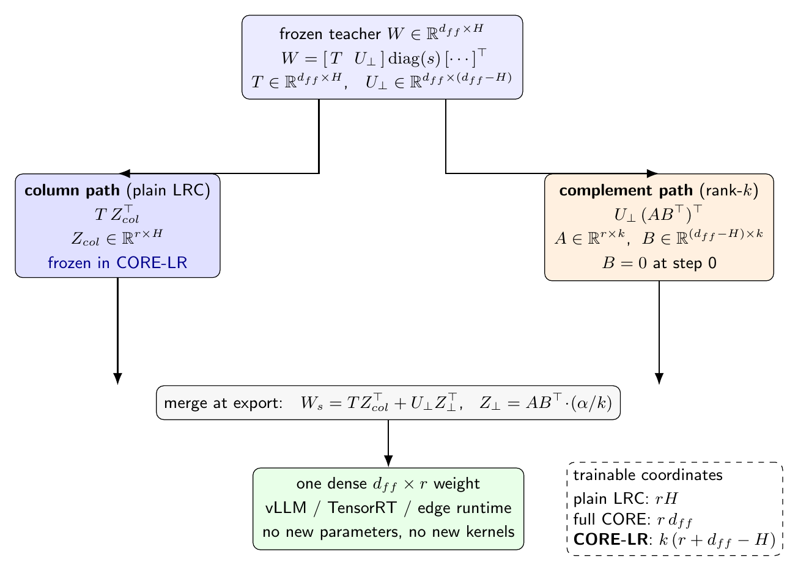

# TWYD — Technical Overview

**Train What You Deploy: closing the MLP reachability gap in low-rank clone distillation.**

This is the engineering reference for the TWYD implementation in this repository: the math, the
three realizations, the training contract, the measurement tooling, and the honest list of known
deviations from the paper. For the investor-facing story see [`../README.md`](../README.md); for the
research and execution plan see [`ROADMAP.md`](ROADMAP.md).

- Paper: *Train What You Deploy* (arXiv:2609.02006)
- Reference method: Low-Rank Clone (LRC), Hao et al., NeurIPS 2025
- Runtime: ms-swift 4.x + PyTorch 2.9 (ROCm/CUDA), bf16
- Status: `plain_lrc` / `dense_lrc` / `core_lrc` tuners, `lrc_distill` loss, merge/export, CORE-LR
  (rank-`k` complement), zero-PT ridge warm starts, rank-map, and the P6 equal-parameter control all
  run end-to-end. Read [§12 Known deviations](#12-known-deviations) before quoting numbers.

---

## Contents

1. [The reachability gap](#1-the-reachability-gap)
2. [Three realizations](#2-three-realizations)
3. [Training objective](#3-training-objective)
4. [Model pairs and coordinate budgets](#4-model-pairs-and-coordinate-budgets)
5. [Quickstart](#5-quickstart)
6. [The step-0 gate](#6-the-step-0-gate)
7. [Warm starts and official LRC checkpoints](#7-warm-starts-and-official-lrc-checkpoints)
8. [CORE-LR internals](#8-core-lr-internals)
9. [Measurement tooling](#9-measurement-tooling)
10. [Performance engineering](#10-performance-engineering)
11. [Experiment protocol](#11-experiment-protocol)
12. [Known deviations](#12-known-deviations)
13. [Reproducibility log](#13-reproducibility-log)
14. [Figure sources](#14-figure-sources)

---

## 1. The reachability gap

A width-reduced student inherits the teacher's MLP intermediate width. For a gate/up projection the
deployed matrix is

$$
W_s \in \mathbb{R}^{d_{ff}\times r}, \qquad r = d^{(S)}_{model} < H = d^{(T)}_{model} < d_{ff}.
$$

Plain LRC parameterizes it as $W_s = T Z_{col}^{\top}$ with $T\in\mathbb{R}^{d_{ff}\times H}$ an
orthonormal basis of the teacher column space $\mathrm{col}(W)$ and only
$Z_{col}\in\mathbb{R}^{r\times H}$ trainable. The deployed matrix is served at full width, but the
optimizer can only move inside a *slice* of it:

$$
u \;=\; \frac{\dim \mathrm{col}(T)}{d_{ff}} \;=\; \frac{1}{\rho},
\qquad \rho = \frac{d_{ff}}{d_{model}},
\qquad \text{stranded} \;=\; 1-\frac{1}{\rho}.
$$

| Teacher → student | $H$ | $d_{ff}$ | $r$ | $d_{ff}-H$ | $\rho$ | stranded |
|---|---:|---:|---:|---:|---:|---:|
| Llama-3.2-3B → 1.5B | 3072 | 8192 | 1536 | 5120 | 2.67 | **62.5%** |
| Llama-3.1-8B → 2.7B | 4096 | 14336 | 1536 | 10240 | 3.50 | 71.4% |
| Qwen2.5-3B → 1.7B | 2048 | 11008 | 1200 | 8960 | 5.375 | **81.4%** |

The complement is *structural*, not numerical noise: for gate/up it is the left orthogonal complement
$\mathrm{col}(W)^{\perp}=\mathrm{null}(W^{\top})$; for down it is the right complement. The objective of
TWYD is exactly one line: **make the training object the entire deployed matrix.**



<p align="center">
  
</p>

> Source: [`figures/reachability_gap.tex`](figures/reachability_gap.tex) (standalone TikZ).

## 2. Three realizations

All three start from the *same* merged plain-LRC warm start and merge back to the *same* deployed
shape, so any accuracy difference is attributable to the reachable set, not to deployment.

### 2.1 Plain-LRC (matched baseline)

$$
W_s = T Z_{col}^{\top}, \qquad \text{trainable} = rH \ \text{per projection}.
$$

### 2.2 Dense-LRC (canonical realization)

Train the full deployed matrix as a plain dense weight, initialized at the merged plain-LRC weight.
No basis, no reparameterization, no inference overhead. Trainable $= r\,d_{ff}$ per projection.

### 2.3 CORE-LRC (teacher-spectral realization)

$$
W_s \;=\; \underbrace{T Z_{col}^{\top}}_{\subseteq\,\mathrm{col}(W)}
      \;+\; \underbrace{U_\perp Z_\perp^{\top}}_{\subseteq\,\mathrm{col}(W)^\perp},
\qquad [\,T\ U_\perp\,]\ \text{orthogonal}.
$$

$Z_\perp$ is zero-initialized, so step 0 is exactly the plain-LRC student and the warm start is never
perturbed. At export both paths fold into one $d_{ff}\times r$ matrix (zero added parameters/FLOPs).

### 2.4 CORE-LR (the research contribution in this repo)

Full CORE trains $r(d_{ff}-H)$ complement coordinates per projection — on Llama-3B→1.5B that is
**660M** trainable coordinates, and the frozen bases cost 11.2 GiB. CORE-LR factorizes the complement
map:

$$
Z_\perp = A B^{\top}\!\cdot\!\frac{\alpha}{k},
\qquad
A\in\mathbb{R}^{r\times k},\quad B\in\mathbb{R}^{(d_{ff}-H)\times k},\quad
\text{trainable} = k\,(r+d_{ff}-H).
$$

Every trainable coordinate still lives in $\mathrm{col}(T)^\perp$; the update rank is at most $k$;
the merged weight is unchanged. The plain-LRC column path is frozen (`freeze_col=true`), so the
comparison "CORE-LR(k) vs full CORE" must use a full-CORE arm with the *same* frozen column path.



<p align="center">
  
</p>

> Source: [`figures/core_lr_pipeline.tex`](figures/core_lr_pipeline.tex) (standalone TikZ).

### 2.5 P6 — the equal-parameter reachable-set control

The decisive control for "capacity, not parameter count" (paper §6.1) writes the *same number* of
trainable coordinates back **inside** the teacher slice:

$$
W_s = T\big(Z_{col}^{\top} + A Z_{red}^{\top}\big),
\qquad Z_{red}\in\mathbb{R}^{r\times(d_{ff}-H)},\quad A\in\mathbb{R}^{H\times(d_{ff}-H)}\ \text{fixed}.
$$

Implementation: `TWYD_PERP_BASIS=col` replaces the complement basis with `T @ A` (fixed random,
scaled Gaussian), so parameter shapes and counts are identical to CORE but the reachable set is still
$\mathrm{col}(T)$. Locked by
`tests/test_core_lr.py::test_col_completion_control_same_params_but_no_new_directions`.

## 3. Training objective

Per token, following the paper (Eq. 6–7):

$$
\mathcal{L}
= w_{KL}\,T^{2}\,\mathrm{KL}\!\left(\sigma(z_T/T)\,\|\,\sigma(z_S/T)\right)
+ w_{NTP}\,\mathrm{CE}(y,z_S)
+ \lambda_{aux}\,\mathcal{L}_{align},
$$

$$
\mathcal{L}_{align}=\frac{1}{L}\sum_{\ell=1}^{L}
\Big\| h^{S}_{\ell}P-h^{T}_{\ell}\Big\|^{2}
+ w_{qk}\sum_{m\in\{Q,K,V,O\}}\!\!\big(1-\cos(a^{S}_{\ell,m},a^{T}_{\ell,m})\big)
+ \big\|\mathrm{MLP}^{S}_{\ell}-\mathrm{MLP}^{T}_{\ell}\big\|^{2}.
$$

Defaults: $w_{KL}=w_{NTP}=1$, $T=40$, $\lambda_{aux}=0.2$, $w_{qk}=1$.
$P\in\mathbb{R}^{r\times H}$ is a parameter-free least-squares projection fitted from the current batch.

Two implementation notes that matter for numerics:

- **KL must be fp32.** At $T=40$ the logits are $\sim10^{-2}$; bf16 resolution at
  $\log p\approx-11.8$ (vocab 128k) is $\sim5\times10^{-2}$, and multiplying by $T^2=1600$ yields a
  *negative* loss. `twyd/loss.py` computes the KL in fp32 and chunks it over the sequence;
  `tests/test_kl_numerics.py` locks this.
- **The projection fit must handle $N<r$.** `torch.linalg.lstsq` only accepts over-determined systems
  on CUDA/ROCm; with $\text{seq}\times\text{batch}<r$ it raises, so the fit uses the minimum-norm
  pseudo-inverse instead (`fit_hidden_projection`) and refuses to compute MSE on mismatched widths.

## 4. Model pairs and coordinate budgets

| Role | Teacher | Student | $r$ | Layers | Note |
|---|---|---|---:|---:|---|
| Paper target (Llama) | Llama-3.2-3B-Instruct | official LRC-1.5B | 1536 | 28 | reproduced here |
| Paper target (Qwen) | Qwen2.5-3B | 1.7B | 1200 | 36 | widest MLP (stranded 81.4%) |
| Cheap proxy | Llama-3.2-1B | width-512 | 512 | 16 | gate-only until a width-512 base exists |

Trainable coordinates per MLP projection (×3 projections ×layers for the total):

| Realization | Per projection | Llama-3B→1.5B total | Share of deployed | Share of full CORE |
|---|---:|---:|---:|---:|
| plain LRC | $rH$ = 4.72M | 396M | 37.5% | 60% |
| Dense-LRC | $r\,d_{ff}$ = 12.58M | 1057M | 100% | 160% |
| full CORE (frozen col) | $r(d_{ff}-H)$ = 7.86M | **660M** | 62.5% | 100% |
| **CORE-LR k=128** | 0.85M | **71.6M** | 6.8% | **10.8%** |
| CORE-LR k=256 | 1.70M | 143M | 13.5% | 21.7% |
| CORE-LR k=512 | 3.41M | 286M | 27.1% | 43.3% |
| dense-LoRA k=128 (PEFT control) | 1.25M | 105M | 9.9% | 15.9% |

Print any row yourself:

```bash
python scripts/param_budget.py --H 3072 --dff 8192 --r 1536 --layers 28 --k 64,128,256,512
```

## 5. Quickstart

```bash
# Environment (ROCm 7900 XTX used for the numbers in this repo)
conda create -n twyd python=3.11 -y && conda activate twyd
pip install -e _upstream/ms-swift
pip install -e .

# 0) mechanics: no GPU, no downloads
pytest tests -q                                  # 57 tests
python scripts/validate_core_lr.py --synthetic   # forward/backward parity + rank map

# 1) step-0 gate: is the warm start alive? (must PASS before spending GPU hours)
python scripts/check_init.py \
  --teacher /path/to/Llama-3.2-3B-Instruct \
  --model   /path/to/LRC-1.5B-Base \
  --r 1536 --branch core --lora-rank 128 --lora-mode core --freeze-col \
  --warm-start base --factorized --seq-len 128 --device cuda

# 2) CORE-LR pilot (20M tokens, one GPU, factorized forward)
CUDA_VISIBLE_DEVICES=0 \
GATE=1 STAGE=pt BRANCH=core K=128 LORA_MODE=core FREEZE_COL=true FACTORIZED=1 \
ALPHA=128 LR=1e-4 BS=1 MAX_LENGTH=512 GRAD_ACCUM=32 TRUNC=split MAX_STEPS=1220 \
DATASET=/path/to/pt.jsonl \
MODEL=/path/to/LRC-1.5B-Base TEACHER=/path/to/Llama-3.2-3B-Instruct \
MODEL_TYPE=llama TEMPLATE=llama3_2 WARM_START=base \
OUT=output/corelr-k128 bash scripts/train_core_lr_pilot.sh

# 3) deployment contract: live graph vs exported merged model
python scripts/check_merge_parity.py \
  --teacher /path/to/Llama-3.2-3B-Instruct --model /path/to/LRC-1.5B-Base \
  --r 1536 --branch core --lora-rank 128 --factorized --steps 2 --device cuda

# 4) what did the optimizer actually use? complement spectrum of a trained ckpt
python scripts/measure_complement_rank.py \
  --student output/dense-pt/checkpoint-1220 \
  --teacher /path/to/Llama-3.2-3B-Instruct \
  --layers all --topk 32,64,128,256,512 --json-out output/rank_spectrum.json
```

`train_core_lr_pilot.sh` is the single entry point for every arm — `BRANCH` selects
`plain|dense|core`, `K=0` gives full CORE, `LORA_MODE=core|dense` places the adapter,
`PERP_BASIS=teacher|col` selects CORE vs the P6 control, `STAGE=pt|sft`, `TRUNC=split` keeps long
documents, and `GATE=1` refuses to train on a dead warm start.

## 6. The step-0 gate

A width-reduced student is only trainable if the warm start already tracks the teacher. The gate
(`scripts/check_init.py`) builds exactly what training builds, then reports basis-free statistics on
one text slice:

| Check | Threshold | Why |
|---|---|---|
| student CE | ≤ 6.0 | uniform distribution over a 128k vocab is ≈11.8 |
| token accuracy | ≥ 0.20 and ≥ 0.50× teacher | absolute floor + relative floor |
| top-1 agreement with teacher | ≥ 0.30 | basis-free: no shared projection needed |
| hidden cosine (optional `--cos-check`) | ≥ 0.5 | only meaningful for slice-type inits |

A trained LRC base uses its own residual basis and scale, so its hidden cosine is ≈0 even when it is a
perfectly good student (measured −0.005). Do not gate on cosine for official checkpoints.

Measured on the reference pair (Llama-3.2-3B → LRC-1.5B-Base, `k=128`, factorized):

```text
[adapter] branch=core lora_mode=core perp_basis=teacher k=128 -> CORE-LR modules=84, Dense-LoRA modules=0
[params]  trainable tensors=168 params=71.6M
teacher CE=3.081 tok_acc=0.500
student CE=3.181 tok_acc=0.487 top1_agree=0.769  -> PASS
```

## 7. Warm starts and official LRC checkpoints

`warm_start` decides what the student's MLP is initialized from:

| Mode | What it does | When to use |
|---|---|---|
| `slice` | teacher top-left slice | never (fails the gate; kept for ablation) |
| `base` | load an official width-`r` LRC checkpoint and re-decompose it exactly against the teacher SVD basis: $W=T Z_{col}^{\top}+U_\perp Z_\perp^{\top}$ | **recommended zero-PT path** |
| `ridge` | online streaming ridge calibration on a small calibration set, then split into `Z_col` / `Z_perp` | when no official base exists |
| `ridge_ckpt` | offline `.pt` produced by `scripts/calib_ridge.py` | same, precomputed |
| `pt_ckpt` | a previously merged TWYD PT checkpoint (keeps the complement residual) | PT → SFT |

An official LRC release is a **hidden-size-halved dense student**: its MLP is a plain
$d_{ff}\times r$ weight with no $T$, $U_\perp$, $Z_{col}$ or $Z_\perp$. TWYD re-expresses that weight
in the teacher basis as a coordinate change; it does not require the checkpoint to have been trained
with SVD.

```bash
# official width-r base, column path frozen, only the rank-k complement trains
TWYD_WARM_START=base TWYD_R=1536 TWYD_FREEZE_COL=1 \
TWYD_LORA_RANK=128 TWYD_LORA_MODE=core \
swift pt --model /path/to/official-lrc-r1536 --tuner_type core_lrc ...
```

Measured on `LRC-1.5B-Base` vs the Llama-3.2-3B teacher: the base's complement energy is
$\lVert Z_\perp\rVert_F/\lVert W\rVert_F \approx 0.13\%$ — i.e. it is plain LRC up to numerics, exactly
as the parameterization guarantees. Consequence: the low-rank structure of the complement **cannot be
inferred from the base**; it must be measured after a full-MLP run (§11, Stage 1).

## 8. CORE-LR internals

`CoreLinearLoRA` is a mergeable module with two paths:

```text
left  (gate/up): W = T Z_col^T + U_perp (A B^T)^T * scaling      W: d_ff x r
right (down):    W = Z_col R   + (A B^T) V_perp * scaling        W: r x d_ff
```

- **Step-0 invariance.** `B = 0`, `A` random (standard LoRA init). Both-zero would make
  `dL/dA = grad·B` and `dL/dB = A^T·grad` vanish, freezing CORE-LR at the plain-LRC point forever.
  A regression test guards this (`test_lora_b_gradient_is_nonzero_at_init`).
- **Factorized forward** (`FACTORIZED=1`, requires `freeze_col=true`): caches the frozen plain-LRC
  matrix `W_col` and evaluates only the low-rank delta,
  `y = F.linear(x, W_col) + ((x @ A) @ (B.T @ U.T)) * scaling`. This is the only shape that does not
  slow training down (1.21× dense per layer vs 3.67× for the merged rebuild).
- **Scaling.** `scaling = alpha/k`. Use `alpha = k` (scaling 1.0) so CORE-LR's update magnitude is
  comparable to full CORE, which updates `Z_perp` directly.
- **Rank map.** `TWYD_RANK_MAP='{"layers.0.gate_proj":128,"down_proj":64}'` (JSON string or file) sets
  a per-module `k`; resolution is exact name → longest suffix → bare projection name.
- **Freeze column.** `TWYD_FREEZE_COL=true` keeps `Z_col` frozen (no optimizer state) and trains only
  the complement. For the paper-exact full CORE (column also trainable) set it to `false`.

## 9. Measurement tooling

| Script | Question it answers |
|---|---|
| `scripts/param_budget.py` | how many coordinates does each realization train? |
| `scripts/check_init.py` | is the warm start alive at step 0? (gate) |
| `scripts/check_merge_parity.py` | does the exported merged model equal the trained one? |
| `scripts/measure_complement_rank.py` | how many complement directions did training actually use? |
| `scripts/bench_layer_flops.py` | what does one MLP projection cost per step, per realization? |
| `scripts/validate_core_lr.py` | are factorized and merged forwards/backwards numerically equal? |
| `scripts/calib_ridge.py` | data-aware zero-PT warm start (streaming ridge) |
| `scripts/convert_ckpt.py`, `scripts/convert_lrc_to_twyd.py` | bring external LRC checkpoints into TWYD coordinates |
| `scripts/make_calib_ids.py` | build the packed calibration set for ridge |

The rank spectrum is the design tool for CORE-LR: for every layer/projection it decomposes a trained
deployed weight into `col(T)` and its complement, and reports Frobenius/spectral norms, stable rank,
entropy effective rank, and top-k energy of `Z_perp`. If top-k energy saturates at `k << r`, a
rank-k complement should recover the full-CORE gain at a fraction of the coordinates.

## 10. Performance engineering

Measured on one RX 7900 XTX (24 GB), Llama-3.2-3B teacher pinned on-device, gradient checkpointing.

| Symptom | Root cause | Fix |
|---|---|---|
| `GPU use 0%`, 3.18 s/step | teacher loaded with `device_map="cpu"` and re-copied every step (5.98 GiB over PCIe) | pin once; 1431 ms → 89 ms per step |
| negative `train_loss` | bf16 KL at `T=40` is pure rounding noise | fp32 chunked KL (`test_kl_numerics.py`) |
| 2–5 min of GPU idle at start | 84 CPU SVDs for the teacher basis | `TWYD_BASIS_CACHE_DIR` content-hash cache: 1.70 s → 0.02 s per projection |
| CORE-LR slower than dense | rebuilding `basis_col @ z_col.T` every forward | `FACTORIZED=1` (1.21× dense per layer) |
| attention OOM at 2048 | math/eager SDPA materializes `S×S` | SDPA + AOTriton (`TORCH_ROCM_AOTRITON_ENABLE_EXPERIMENTAL=1`) |

Single-layer cost at `seq=512` (`scripts/bench_layer_flops.py`, H=2048, d_ff=8192, r=512, k=128):

| case | ms/step | × dense |
|---|---:|---:|
| dense W (r→d_ff) | 1.451 | 1.00× |
| dense-LoRA k=128 | 1.547 | 1.07× |
| full CORE (merged rebuild) | 6.417 | 4.42× |
| CORE-LR k=128 merged | 5.319 | 3.67× |
| **CORE-LR k=128 factorized** | **1.758** | **1.21×** |

Memory on the reference pair (CORE-LR k=128, factorized): frozen complement basis is 7.0 GiB on
device, `W_col` cache 2.1 GiB, teacher 6.0 GiB, student + activations the rest — measured 17.6–18.6 GiB
at `seq=512–1024`. Dense-LRC (1.057B trainable) peaks at 17.3–19.5 GiB at `seq=512`, and 23.2 GiB at
`seq=1024` (too close to the 24 GB limit; use 512 or a bigger card).

Throughput (single card, `seq=512`, 16,384 tokens/step): dense ≈ 1.8k tok/s (8.98 s/step), CORE-LR
≈ 2.5k tok/s. Full-CORE `K=0` has no factorized forward yet, so every step rebuilds `d_ff×r` and runs
at roughly a quarter of that — the main engineering gap for the full-CORE arm.

## 11. Experiment protocol

The claim to falsify is: *a rank-k complement recovers the full-CORE gain at a fraction of the
coordinates.* Four stages, each behind a gate.


| Gate | Criterion |
|---|---|
| G0 init | student CE ≤ 6.0, token acc ≥ 0.2 and ≥ 0.5× teacher, agreement ≥ 0.3 |
| G1 full CORE | Qwen: CORE > Dense; Llama: CORE ≈ Dense (paper reports a tie) |
| G2 low rank | `k ≤ 256`, within 0.5 Avg9 (or ≤0.05 nats held-out CE) of full CORE, coordinates ≤ 25% of full CORE |
| G3 cost | factorized step time ≤ 0.9× dense, or optimizer state ≤ 70% |
| G4 MoE | only after G2/G3 pass |

**Budget math (Llama-3B→1.5B).** Full CORE (frozen column) = 660M coordinates; CORE-LR k=256 =
143M = **21.7%** (passes G2), k=512 = 286M = 43.3% (fails). At `seq=512` and 16k tokens/step, 20M
tokens/arm is ≈ 3 h on one 7900 XTX for CORE-LR, and ≈ 5 h for Dense-LRC (optimizer-bound).

**Matched-arm discipline.** Same base checkpoint, same data order/seed, same token count, same
`seq`/effective batch, same LR, `alpha=k`, gradient clip 1.0, `T=40`. Report held-out CE/token_acc for
screening runs; only spend Avg9 on runs long enough to be meaningful.

## 12. Known deviations

These are real and should be disclosed with any number produced by this repo.

1. **`L_align` is a subset of Eq. 7.** The implementation aligns hidden states on 4 layers
   (`max_aux_layers=4`) with one shared least-squares `P`; there is no attention Q/K/V/O cosine term
   and no MLP-intermediate term. All arms share it, so A/B comparisons are internally consistent, but
   absolute numbers are not paper-reproducible. A full `L_align` is on the roadmap.
2. **Aux was silently disabled before 2026-10-21.** `torch.linalg.lstsq` refuses under-determined
   systems on ROCm; the exception was swallowed, so `L_align` never contributed. Fixed with a
   `pinv` fallback + shape guard + a one-time log line. **Any earlier run with `lambda_aux=0.2` was
   effectively `aux=0`.**
3. **The factorized training graph is not bit-identical to the deployed graph.** Weights match exactly
   (`max|ΔW| = 0`), but bf16 logits differ by ~1.8% relative (max 0.375 on a logit scale of ~20).
   Evaluate the **merged** checkpoint, never the live factorized model.
4. **`TWYD_LORA_LR` is parsed but not wired** into the optimizer; only the global LR applies.
5. **`CoreLinear` (full CORE) has no factorized forward**, so `K=0` pays a `d_ff×r` rebuild per step
   (4.4× dense) and keeps the column basis on device (11.2 GiB). This is the next engineering item.
6. **`truncation_strategy` defaults to `delete` upstream.** ms-swift drops samples longer than
   `max_length`; a 35M-token corpus collapsed to 2,992 short samples (≈1.1M unique tokens repeated
   18×). The pilot script now defaults to `TRUNC=split` (chunks, no cross-document attention).
7. **Screening corpus.** Current runs use FineWeb-Edu `int_score>=4` (60M tokens from one shard), not
   the paper's 10B-token mixed recipe; sequence length is 512, not 2048. AUX is disabled for those
   screening arms because the official LRC base's hidden states are not in the teacher basis
   (`L_align ≈ 400` would dominate the loss without the Alg.1 master projection `P`).

## 13. Reproducibility log

Verified in this working tree (ROCm 6.4, torch 2.9.1, transformers 5.17):

```text
pytest tests -q                                57 passed
python scripts/validate_core_lr.py --synthetic left/right parity + rank map PASS
scripts/check_init.py (3B -> LRC-1.5B, k=128) 84 CORE-LR modules, 71.6M, CE 3.181, agree 0.769, PASS
scripts/check_merge_parity.py (k=128, merged) max|dW| = 0, max|dlogit| = 0
scripts/check_merge_parity.py --factorized    max|dW| = 0, max|dlogit| = 0.375 (1.8% rel)
scripts/bench_layer_flops.py --seq 512        factorized 1.21x dense; merged 3.67x
```

End-to-end smoke (1.5B student, 3B teacher, `seq=512`, batch 1): 17.6 GiB peak, ~1.25 s per
micro-batch, `grad_norm` 0.93 after the LoRA-init fix, exported checkpoint = 254 plain dense tensors
(no `z_col`, no `lora_*`).

## 14. Figure sources

| File | Content | Build |
|---|---|---|
| [`figures/reachability_gap.tex`](figures/reachability_gap.tex) | deployed matrix vs trainable slice, stranded fraction | `pdflatex reachability_gap.tex` |
| [`figures/core_lr_pipeline.tex`](figures/core_lr_pipeline.tex) | teacher SVD → frozen column + rank-k complement → merge → deploy | `pdflatex core_lr_pipeline.tex` |

Both are standalone TikZ documents (no external assets) and can be `\input` into a paper with
`\usetikzlibrary{arrows.meta,patterns,positioning,calc,fit,backgrounds}`.

## Citation

```bibtex
@article{chen2026twyd,
  title  = {Train What You Deploy: Closing the MLP Reachability Gap in Low-Rank Clone Distillation},
  author = {Chen, Wenhui and Mao, Qingqing and Li, Zhifeng and Zhou, Jie and Wang, Chenghua},
  year   = {2026},
  note   = {arXiv:2609.02006}
}
```


